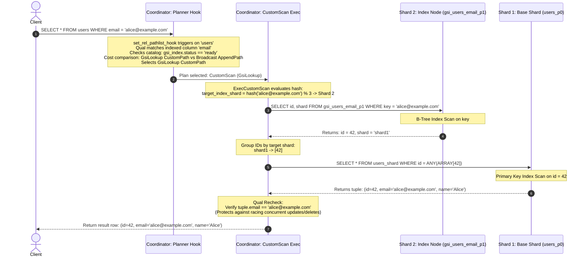
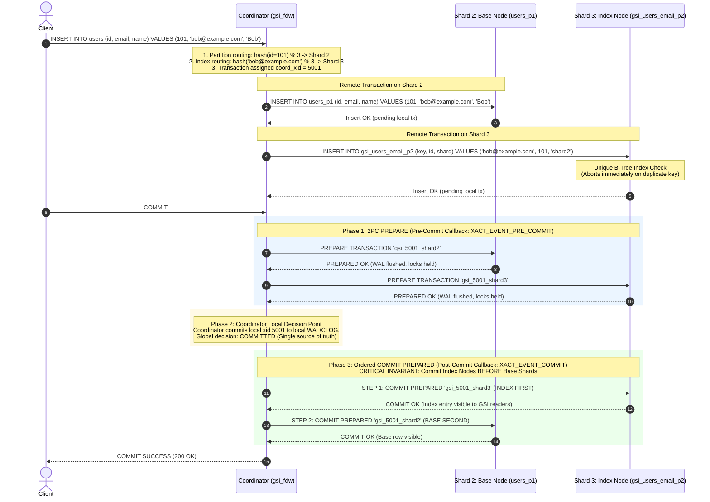
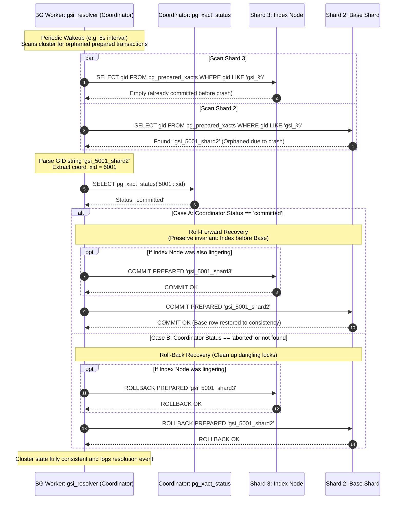

# Distributed Global Secondary Index (GSI) Maintenance for Sharded PostgreSQL: Baseline Architecture Plan & System Schematic

**Status:** Approved Baseline Architecture Specification  
**Target Engine:** PostgreSQL 16 (Debian Bullseye/Bookworm)  
**Authors & Engineering Team:**  
- Kunj Bhesaniya (23B0995)  
- Dhruvraj Merchant (23B1041)  
- Dipen Sojitra (23B0913)  
- Harshil Solanki (23B1016)  
**Course Context:** CS 631: Implementation of Relational Databases (Advanced Database Internals)  
**Deliverable File:** `docs/architecture_plan.md`  

---

## 1. Executive Summary & Problem Formulation

### 1.1 The Sharding Challenge: Primary Key Partitioning vs. Secondary Column Bottlenecks
In large-scale relational database deployments, horizontal table partitioning (sharding) divides a massive relation across multiple independent database nodes using a primary partitioning key (e.g., `id`). In native PostgreSQL declarative partitioning with Foreign Data Wrappers (`postgres_fdw`), as well as in distributed extensions like Citus, the query coordinator inspects query filter predicates during query planning. If a query restricts the primary key (e.g., `WHERE id = 42`), the planner applies partition pruning, routing the query directly to the single foreign server hosting that partition.

However, when a client executes a query filtering on a non-partitioning secondary attribute (e.g., `WHERE email = 'alice@example.com'`), the coordinator possesses no routing metadata to isolate the target node. Consequently, the planner falls back to a **scatter-gather broadcast** strategy:
1. The coordinator emits $N$ parallel queries across all $N$ cluster shards via `Append` or `MergeAppend` plan nodes.
2. Every data shard scans its local partition (frequently requiring sequential scans if no shard-local secondary index exists, or index scans across $N$ independent B-trees).
3. The coordinator receives $N$ result streams over the network, unions the results, and discards empty responses.

This scatter-gather pattern imposes an $O(N)$ computational and network overhead that degrades linearly with cluster expansion. As the cluster grows from 3 nodes to 30 nodes, a point lookup that should execute in sub-millisecond time monopolizes execution slots across the entire cluster, inducing CPU churn, buffer pool pollution, network socket saturation, and tail-latency amplification.

### 1.2 The Global Uniqueness Challenge 
A second critical limitation of horizontal sharding is the impossibility of enforcing global cross-shard constraints. In PostgreSQL, unique constraints are enforced locally by shard-level B-tree indexes. Because individual data nodes operate as autonomous database instances without shared memory or cross-partition visibility, Shard 1 cannot detect when a concurrent transaction inserts a duplicate attribute into Shard 2. 

Neither core PostgreSQL nor Citus supports distributed global uniqueness constraints on non-partition columns. Applications are forced to either accept duplicate entries, route all writes through external locking systems (e.g., Redis, ZooKeeper), or execute costly distributed pre-checks prone to race conditions under concurrent workloads.
TODO: why are we solving this?
### 1.3 The Global Secondary Index (GSI) Solution Overview
To resolve both the scatter-gather penalty and the uniqueness challenge, this project designs and implements **Distributed Global Secondary Index (GSI) Maintenance for Sharded PostgreSQL**. 

A Global Secondary Index is an index partitioned on the secondary attribute key $k$ (e.g., `email`), completely independent of the base table's primary key placement. The index entries are stored as explicit tuples of the format:
$$\text{GSI Entry} = (\text{key}, \text{id}, \text{shard})$$ TODO: Why is shard needed here?
where:
- $\text{key}$: The indexed secondary column value (e.g., `alice@example.com`).
- $\text{id}$: The primary key of the corresponding base table tuple.
- $\text{shard}$: The identifier of the base shard hosting the primary tuple (e.g., `shard_1`).

Index placement is governed by a consistent hash function:
$$\text{Index Node} = \text{hash}(\text{key}) \pmod N$$

By partitioning the index by key hash, point lookups achieve $O(1)$ network complexity via an exact **two-hop query execution**:
1. **Hop 1 (Index Scan):** Query the single index node hosting $\text{hash}(\text{key}) \pmod N$ to retrieve the primary key `id` and owning `shard`.
2. **Hop 2 (Targeted Base Fetch):** Query only the target base shard with `WHERE id = ANY(...)`, eliminating broadcast to uninvolved shards.

Furthermore, because all index entries for a specific key $k$ are routed to the exact same index shard, **global uniqueness is enforced natively** via a local `UNIQUE` B-tree index on that shard. Any concurrent insertion of a duplicate key across different base shards collides at the target index node and is rejected at the storage layer. TODO: CAnnot understand paragraph, how is uniqueness enforced, give example

### 1.4 Evolution: Single-Node Parquet GSI to Distributed Multi-Node 2PC Architecture
During the preceding semester, the team implemented a single-node secondary index engine operating over immutable, append-only Apache Parquet files. While that work addressed columnar metadata pruning and vectorized dictionary lookups, it operated within a single process address space under append-only invariants.

This project addresses an entirely distinct, orders-of-magnitude more demanding systems engineering problem: **maintaining a partitioned mutable index consistent across independent distributed database servers under concurrent DML, network partitions, and node crashes**. In a distributed cluster:
- Every insert, update, or delete touches two distinct physical nodes: the base shard and the index node.
- Concurrent transactions can modify the base row and index entry simultaneously.
- Coordinator and worker crashes can strand partial writes, leading to dangling index pointers or phantom records.

### 1.5 Scope Breakdown: Core Deliverables vs. Stretch Goals

| Subsystem | Scope Classification | Key Architectural Requirements |
|---|---|---|
| **Cluster Topology** | **Core Deliverable (Mandatory)** | 4 PostgreSQL 16 containers (1 coordinator + 3 data nodes) orchestrated via Docker Compose on an isolated bridge network (`gsi_cluster_net`), dual-role node storage, `max_prepared_transactions >= 100`. |
| **Synchronous 2PC Write Path** | **Core Deliverable (Mandatory)** | `gsi_fdw` write interception (`ExecForeignInsert/Update/Delete`), disabled direct modify and batching, distributed 2PC (`PREPARE TRANSACTION`), coordinator local commit decision point, strict index-first commit ordering invariant. |
| **Global Uniqueness** | **Core Deliverable (Mandatory)**| Unique B-trees on index shards aborting conflicting transactions during Phase 1 PREPARE. TODO: This is not our Goal |
| **Crash Recovery Resolver** | **Core Deliverable (Mandatory)** | Autonomous coordinator background worker (`gsi_resolver`) scanning `pg_prepared_xacts`, inspecting coordinator CLOG via `pg_xact_status(xid)`, resolving in-doubt distributed transactions. |
| **CustomScan Read Path** | **Core Deliverable (Mandatory)** | Planner hook (`set_rel_pathlist_hook`), `GsiLookup` `CustomPath`, two-hop targeted execution, and mandatory base tuple qual recheck. |
| **Evaluation Framework** | **Core Deliverable (Mandatory)** | Automated cross-node consistency checker (`checker.py`), `gsi.fail_point` crash fault injection harness, and `pgbench` performance benchmarking suite. |
| **Asynchronous WAL Pipeline** | **Stretch Goal (Secondary)** | C logical decoding output plugin (`gsi_decoder`) on data nodes with `REPLICA IDENTITY FULL`, coordinator applier background worker (`gsi_applier_worker`), idempotent upserts, and bounded replication lag tracking. |
| **Online Index Build Engine** | **Stretch Goal (Secondary)** | Google F1 asynchronous schema change state machine (`write-only` $\rightarrow$ `backfill` with `ON CONFLICT DO NOTHING` $\rightarrow$ `validation` $\rightarrow$ `ready`). |

---

## 2. System Prerequisites & Environment Matrix

### 2.1 Host & Container Requirements
- **Host Operating System:** Linux (Ubuntu 22.04 LTS / Debian 12 recommended) or Windows 10/11 with WSL2 / Docker Desktop.
- **Containerization Engine:** Docker Engine v24.0+ and Docker Compose v2.20+.
- **Base Container Image:** `postgres:16-bullseye` or `postgres:16-bookworm` (Debian GNU/Linux).

### 2.2 PostgreSQL Engine & Toolchain Specifications
- **PostgreSQL Version:** PostgreSQL 16.x.
  - *Engine Rationale:* PostgreSQL 16 provides mature, stable APIs for `CustomPath` and `CustomScan`, allows `set_rel_pathlist_hook` to intercept partitioned relations, features unified logical decoding streaming architecture, and offers robust connection handling in `postgres_fdw`.
- **Compiler & Build Tools:**
  - `gcc` (v10+ / v12+)
  - `make` (GNU Make 4.3+)
  - `postgresql-server-dev-16` (PostgreSQL Extension Network / PGXS build environment)
  - `libpq-dev` (PostgreSQL client library headers)
- **Evaluation & Test Dependencies:**
  - Python 3.10+
  - `psycopg2-binary` (v2.9+)
  - `pytest` (v7.0+)
  - `pgbench` (bundled with PostgreSQL 16 client tools)

### 2.3 Mandatory PostgreSQL GUC Settings Matrix

The following configuration parameters must be set across the cluster nodes. Any deviation renders 2PC or logical decoding non-functional:

| Configuration Parameter | Coordinator Node | Data Shard Nodes | Engine Default | Mandatory Requirement Rationale |
|---|---|---|---|---|
| `max_prepared_transactions` | `100` | `100` | `0` | **Mandatory for 2PC.** PostgreSQL disables `PREPARE TRANSACTION` when set to `0`. If not configured, issuing `PREPARE` throws SQLSTATE `55000` (`OBJECT_NOT_IN_PREREQUISITE_STATE`). Must be $\ge \text{max\_connections}$. |
| `wal_level` | `logical` | `logical` | `replica` | **Mandatory on data nodes** for WAL logical decoding in asynchronous mode. On coordinator, facilitates logical replication streaming. |
| `shared_preload_libraries` | `'gsi_fdw'` | `'gsi_fdw'` | `''` | Required on coordinator to load planner hooks (`set_rel_pathlist_hook`), transaction callbacks, and register background workers (`gsi_resolver`, `gsi_applier_worker`). |
| `max_worker_processes` | `16` | `8` | `8` | Allocates sufficient worker process slots for PostgreSQL core, the resolver background worker, and up to 3 asynchronous applier workers without pool starvation. |
| `max_replication_slots` | `10` | `10` | `10` | Required on data nodes to maintain persistent replication slots for asynchronous WAL change streaming. |
| `max_wal_senders` | `10` | `10` | `10` | Accommodates concurrent WAL sender streaming connections from the coordinator applier workers. |
| `track_commit_timestamp` | `on` | `on` | `off` | Attaches commit timestamps to WAL records, enabling exact millisecond replication lag tracking in asynchronous mode. |
| `listen_addresses` | `'*'` | `'*'` | `'localhost'` | Binds PostgreSQL listening sockets to all container network interfaces over the Docker bridge network. |

### 2.4 Network Authentication & Security Configuration
The cluster uses PostgreSQL trust/md5 authentication over the private Docker subnet `172.28.0.0/16`. The file `pg_hba.conf` across all containers includes:

```
# TYPE  DATABASE        USER            ADDRESS                 METHOD
local   all             all                                     trust
host    all             all             127.0.0.1/32            trust
host    all             all             172.28.0.0/16           trust
host    replication     all             172.28.0.0/16           trust
```

### 2.5 Packaging & Extension Rationale
All coordinator-side logic is unified into a single C extension module: **`gsi_fdw`** (a fork and modification of PostgreSQL's standard `contrib/postgres_fdw`).
- **Connection Cache Reuse:** Standard `postgres_fdw` contains optimized libpq connection management (`pgfdw_connections` hash table) that caches open connections to remote servers across transactions. Reusing this layer avoids opening new TCP connections per row or per transaction.
- **Transaction State Synchronization:** `postgres_fdw` provides foreign server transaction tracking callbacks (`XACT_EVENT_PRE_COMMIT`, `XACT_EVENT_COMMIT`, `XACT_EVENT_ABORT`). `gsi_fdw` hooks directly into these callbacks to inject the 2PC state machine and enforce commit ordering.
- **Data Node Footprint:** Data nodes run standard PostgreSQL 16 instances without requiring invasive core engine patches. For stretch asynchronous mode, a lightweight logical decoding output plugin (`gsi_decoder.so`) is installed on the data nodes.

---

## 3. Node Topology & Docker Network Architecture

### 3.1 Physical Container Layout & Port Mapping
The cluster comprises **four PostgreSQL 16 container instances** orchestrated via Docker Compose:
- **1 Coordinator Node (`gsi-coordinator`):** Receives client DML and query traffic, executes distributed query planning and execution, coordinates distributed transactions, and hosts recovery background workers.
- **3 Data Nodes (`gsi-shard-1`, `gsi-shard-2`, `gsi-shard-3`):** Function as dual-role storage engines hosting base table partitions and GSI index partitions.

| Container Name | Role in Cluster | Internal DNS | Container Port | Host Port | Internal IP (Subnet: `172.28.0.0/16`) |
|---|---|---|---|---|---|
| `gsi-coordinator` | Query Coordinator & Catalog Master | `coordinator` | `5432` | `5432` | `172.28.0.10` |
| `gsi-shard-1` | Data Node 1 (Base Partition 0 + Index Partition 0) | `shard1` | `5432` | `5433` | `172.28.0.11` |
| `gsi-shard-2` | Data Node 2 (Base Partition 1 + Index Partition 1) | `shard2` | `5432` | `5434` | `172.28.0.12` |
| `gsi-shard-3` | Data Node 3 (Base Partition 2 + Index Partition 2) | `shard3` | `5432` | `5435` | `172.28.0.13` |

### 3.2 Dual-Role Storage Node Architecture
Rather than maintaining separate clusters for base tables and index tables, each data node performs a **dual role**:
1. **Base Table Shard:** Stores horizontal slices of the primary relation partitioned by primary key:
   $$\text{Base Partition} = \text{hash}(\text{id}) \pmod 3$$
2. **GSI Index Shard:** Stores slices of the global secondary index partitioned by the secondary attribute:
   $$\text{Index Partition} = \text{hash}(\text{key}) \pmod 3$$

Because the hash of a row's primary key `id` and the hash of its secondary key `email` are completely independent, a tuple's base row and its secondary index entry will frequently reside on **different physical data nodes**. For example, a row with `id = 101` and `email = 'bob@example.com'` may store its base data on `shard2` while its index pointer resides on `shard3`.

### 3.3 Cluster Node Topology & Docker Network Layout Diagram

The embedded diagram below illustrates the physical container boundaries, port mappings, internal network connections, and data placement:

```mermaid
flowchart TB
    subgraph DockerHost["Docker Host: bridge network (gsi_cluster_net)"]
        subgraph Coord["Coordinator Container (gsi-coordinator)\nHost Port: 5432:5432 | DNS: coordinator"]
            CoordPG["PostgreSQL 16 Instance\n(shared_preload_libraries = 'gsi_fdw')\n(max_prepared_transactions = 100)"]
            CoordCatalog["Catalog Table: gsi_index\n(name, base_table, column, mode, status)"]
            CoordTable["Partitioned Table: users\nPARTITION BY HASH (id)"]
            CoordHook["Planner Hook: set_rel_pathlist_hook\n(GsiLookup CustomPath Generator)"]
            CoordScan["Executor: CustomScan\n(GSI Query + Targeted Fetch + Recheck)"]
            Coord2PC["FDW 2PC Engine\n(Pre-commit PREPARE, Local Commit, Ordered COMMIT PREPARED)"]
            CoordResolver["Background Worker: gsi_resolver\n(Periodic pg_prepared_xacts recovery)"]
            CoordApplier["Background Worker: gsi_applier_worker\n(Async WAL Stream Consumer - Stretch)"]
        end

        subgraph Shard1["Shard 1 Container (gsi-shard-1)\nHost Port: 5433:5432 | DNS: shard1"]
            S1PG["PostgreSQL 16 Instance\n(max_prepared_transactions = 100)\n(wal_level = logical)"]
            S1Base["Base Shard Partition: users_p0\nForeign Table for id % 3 == 0"]
            S1Index["Index Partition: gsi_users_email_p0\nB-Tree UNIQUE for hash(email) % 3 == 0\nColumns: key, id, shard"]
            S1Decoder["Logical Decoding: gsi_decoder\n(WAL change stream plugin - Stretch)"]
        end

        subgraph Shard2["Shard 2 Container (gsi-shard-2)\nHost Port: 5434:5432 | DNS: shard2"]
            S2PG["PostgreSQL 16 Instance\n(max_prepared_transactions = 100)\n(wal_level = logical)"]
            S2Base["Base Shard Partition: users_p1\nForeign Table for id % 3 == 1"]
            S2Index["Index Partition: gsi_users_email_p1\nB-Tree UNIQUE for hash(email) % 3 == 1\nColumns: key, id, shard"]
            S2Decoder["Logical Decoding: gsi_decoder\n(WAL change stream plugin - Stretch)"]
        end

        subgraph Shard3["Shard 3 Container (gsi-shard-3)\nHost Port: 5435:5432 | DNS: shard3"]
            S3PG["PostgreSQL 16 Instance\n(max_prepared_transactions = 100)\n(wal_level = logical)"]
            S3Base["Base Shard Partition: users_p2\nForeign Table for id % 3 == 2"]
            S3Index["Index Partition: gsi_users_email_p2\nB-Tree UNIQUE for hash(email) % 3 == 2\nColumns: key, id, shard"]
            S3Decoder["Logical Decoding: gsi_decoder\n(WAL change stream plugin - Stretch)"]
        end
    end

    Client["Client / Application / pgbench"] -->|"Port 5432: SQL Queries"| CoordPG

    CoordTable -.->|"gsi_fdw foreign table"| S1Base
    CoordTable -.->|"gsi_fdw foreign table"| S2Base
    CoordTable -.->|"gsi_fdw foreign table"| S3Base

    CoordScan -->|"Point Index Lookup: hash(key)%3"| S1Index
    CoordScan -->|"Point Index Lookup: hash(key)%3"| S2Index
    CoordScan -->|"Point Index Lookup: hash(key)%3"| S3Index

    Coord2PC ==>|"2PC PREPARE & COMMIT PREPARED"| S1PG
    Coord2PC ==>|"2PC PREPARE & COMMIT PREPARED"| S2PG
    Coord2PC ==>|"2PC PREPARE & COMMIT PREPARED"| S3PG

    CoordResolver -.->|"Polls pg_prepared_xacts & recovers"| S1PG
    CoordResolver -.->|"Polls pg_prepared_xacts & recovers"| S2PG
    CoordResolver -.->|"Polls pg_prepared_xacts & recovers"| S3PG

    S1Decoder -.->|"Replication stream"| CoordApplier
    S2Decoder -.->|"Replication stream"| CoordApplier
    S3Decoder -.->|"Replication stream"| CoordApplier
```



---

## 4. Catalog Schemas & Metadata Management

### 4.1 Coordinator Metadata Catalog (`gsi.gsi_index`)
The coordinator maintains an authoritative catalog tracking GSI definitions and their lifecycle states: TODO DIfference between index_name and index_table_name?

```sql
CREATE SCHEMA IF NOT EXISTS gsi;

CREATE TYPE gsi_mode AS ENUM ('sync', 'async');
CREATE TYPE gsi_status AS ENUM ('write-only', 'backfill', 'validation', 'ready');

CREATE TABLE gsi.gsi_index (
    index_name        NAME PRIMARY KEY,
    base_table        REGCLASS NOT NULL,
    indexed_column    NAME NOT NULL,
    index_table_name  NAME NOT NULL,
    is_unique         BOOLEAN NOT NULL DEFAULT FALSE,
    mode              gsi_mode NOT NULL DEFAULT 'sync',
    status            gsi_status NOT NULL DEFAULT 'ready',
    num_shards        INT NOT NULL DEFAULT 3,
    created_at        TIMESTAMPTZ DEFAULT clock_timestamp()
);

CREATE TABLE gsi.gsi_shards (
    shard_id          INT PRIMARY KEY,
    server_name       NAME NOT NULL,       -- Foreign server in pg_foreign_server
    host              TEXT NOT NULL,
    port              INT NOT NULL,
    dbname            TEXT NOT NULL
);
```

### 4.2 Coordinator Partitioned Base Table Schema
The base table (e.g., `users`) is declared on the coordinator using PostgreSQL's declarative hash partitioning:

```sql
CREATE TABLE users (
    id          BIGINT NOT NULL,
    email       TEXT NOT NULL,
    name        TEXT,
    created_at  TIMESTAMPTZ DEFAULT clock_timestamp(),
    PRIMARY KEY (id)
) PARTITION BY HASH (id);

CREATE FOREIGN TABLE users_p0 PARTITION OF users
    FOR VALUES WITH (MODULUS 3, REMAINDER 0)
    SERVER shard_node_1 OPTIONS (table_name 'users_shard_0');

CREATE FOREIGN TABLE users_p1 PARTITION OF users
    FOR VALUES WITH (MODULUS 3, REMAINDER 1)
    SERVER shard_node_2 OPTIONS (table_name 'users_shard_1');

CREATE FOREIGN TABLE users_p2 PARTITION OF users
    FOR VALUES WITH (MODULUS 3, REMAINDER 2)
    SERVER shard_node_3 OPTIONS (table_name 'users_shard_2');
```

### 4.3 Data Node Storage Schema
On each data node $i \in \{1, 2, 3\}$, physical tables are created to store the base rows and index entries:

```sql
-- Base table shard on data node
CREATE TABLE users_shard_0 (
    id          BIGINT NOT NULL PRIMARY KEY,
    email       TEXT NOT NULL,
    name        TEXT,
    created_at  TIMESTAMPTZ DEFAULT clock_timestamp()
);

-- GSI index partition on data node
CREATE TABLE gsi_users_email_p0 (
    key         TEXT NOT NULL,
    id          BIGINT NOT NULL,
    shard       TEXT NOT NULL
);

-- For Unique GSI:
CREATE UNIQUE INDEX gsi_users_email_p0_key_idx ON gsi_users_email_p0 (key);

-- For Non-Unique GSI:
-- CREATE INDEX gsi_users_email_p0_key_id_idx ON gsi_users_email_p0 (key, id);
```

### 4.4 Administrative SQL Interface (UDFs)
To provide a clean administrative interface, the extension provides PL/pgSQL management functions:
- `gsi_create(base_table text, column_name text, is_unique boolean, mode text)`: Validates table existence, inserts catalog entry with initial status (`ready` for immediate creation, or `write-only` for online build), and provisions index tables across shards.
- `gsi_drop(index_name text)`: Drops remote index tables across shards and removes the catalog record.
- `gsi_status(index_name text)`: Returns runtime metrics, including mode, status, and async replication lag.

---

## 5. Read Control Flow: Query Planning & Execution Path

### 5.1 Planner Hook Integration (`set_rel_pathlist_hook`)
During query optimization, PostgreSQL invokes `set_rel_pathlist_hook` for every relation being planned. `gsi_fdw` registers a custom hook that intercepts the access path generation for partitioned tables:

```
                                  Client Query:
                      SELECT * FROM users WHERE email = 'alice@example.com';
                                        |
                                        v
                    +---------------------------------------+
                    |        PostgreSQL Core Planner        |
                    +---------------------------------------+
                                        |
                         Invokes set_rel_pathlist_hook
                                        v
                    +---------------------------------------+
                    |    gsi_fdw set_rel_pathlist_hook      |
                    |  1. Inspects baserestrictinfo         |
                    |  2. Finds 'email = const' qual        |
                    |  3. Checks gsi_index: status=='ready' |
                    |  4. Calculates GsiLookup CustomPath   |
                    +---------------------------------------+
                                        |
                     Cost(GsiLookup) << Cost(AppendPath)
                                        v
                    +---------------------------------------+
                    |      Optimizer Selects GsiLookup      |
                    +---------------------------------------+
```

#### Selection & Costing Invariant:
1. **Clause Inspection:** The hook scans `RelOptInfo->baserestrictinfo` for candidate clauses of the form `OpExpr(Var = Const)` matching the indexed column registered in `gsi_index`.
2. **Readiness Check:** The hook confirms `gsi_index.status == 'ready'`. If the index is in `write-only` or `backfill` state, the hook exits without adding a path, allowing core PostgreSQL to generate the standard scatter-gather `AppendPath`.
3. **Cost Modeling:**
   - Standard scatter-gather cost:
     $$\text{Cost}(\text{Append}) = \sum_{i=1}^N \text{Cost}(\text{Scan Shard}_i) + N \cdot \text{Cost}(\text{Network Latency})$$
   - `GsiLookup` CustomPath cost:
     $$\text{Cost}(\text{GsiLookup}) = \text{Cost}(\text{Index Node Lookup}) + \text{Cost}(\text{Targeted Base Shard Fetch}) + 2 \cdot \text{Cost}(\text{Network Latency})$$
   Because $2 \ll N$ for multi-shard clusters and index scans are B-tree lookups rather than full shard scans, the optimizer deterministically selects `GsiLookup`.

### 5.2 Executor Implementation: `CustomScan` (`GsiLookup`)
When the executor executes the `CustomScan` plan node, it implements a **two-hop targeted fetch**:
1. **Hash Placement:** Computes $H = \text{hash}(\text{const}) \pmod N$ using PostgreSQL's internal hash function (e.g. `hashbpchar` or `hashtext`).
2. **Hop 1 — Remote Index Lookup:** Connects to index node $H$ via libpq connection cache and executes:
   ```sql
   SELECT id, shard FROM gsi_users_email WHERE key = $1;
   ```
   For point lookups on a unique index, this returns at most 1 tuple `(id, shard)`. For non-unique indexes, it returns a stream of matching tuples.
3. **Shard Grouping:** The executor aggregates primary keys `id` by target base `shard`.
4. **Hop 2 — Targeted Base Shard Fetch:** For each target shard, the executor dispatches a single targeted query:
   ```sql
   SELECT id, email, name, created_at FROM users_shard WHERE id = ANY($1);
   ```
   *Crucially, shards that do not own matching rows receive zero queries.*
5. **Hop 3 — Base Tuple Qual Recheck (Index as a Speculative Hint):** TODO: Why are we not using locking startegies for this?
   Upon receiving the base tuple from the shard, the coordinator executor re-evaluates the original restriction qual (`email = 'alice@example.com'`) on the returned tuple before passing it to the client.
   - *Why Recheck is Critical:* The index entry is treated as a speculative hint. If a concurrent transaction updated the row's email immediately after the index lookup occurred, or if an asynchronous index contains a stale pointer, the base shard fetch returns the latest snapshot row. The qual recheck filters out the tuple, completely preventing stale or corrupt phantom rows from surfacing.

### 5.3 Range Query Execution Strategy
For range predicates (e.g., `WHERE email >= 'alice@example.com' AND email < 'charlie@example.com'`):
- Because the index is hash-partitioned on `hash(key)`, a single index shard does not contain contiguous key ranges.
- The planner dispatches range queries to **all index nodes in parallel**.
- The coordinator merges the resulting `(id, shard)` sets, groups by shard, and executes targeted fetches `WHERE id = ANY(...)`.
- This remains significantly faster than scanning base tables because index B-trees prune the range efficiently, and base shard reads are limited strictly to matching rows.

### 5.4 Read Control Flow Sequence Diagram

The embedded diagram below details the sequence of interactions between the client, coordinator planner/executor, target index node, and target base shard:



---

## 6. Synchronous Write Control Flow & Two-Phase Commit (2PC)

### 6.1 Mutation Interception Architecture
When DML operations (`INSERT`, `UPDATE`, `DELETE`) target a partitioned table governed by an active GSI:
1. **Direct Modify Disabled (`PlanDirectModify`):**
   Standard `postgres_fdw` attempts to push entire DML trees down to remote shards (`PlanDirectModify`). For GSI-tracked tables, `gsi_fdw` unconditionally overrides `PlanDirectModify` to return `false`. This forces PostgreSQL to evaluate every tuple row-by-row on the coordinator, ensuring per-row execution callbacks are invoked.
2. **Batch Insert Disabled (`GetForeignModifyBatchSize`):**
   Batching is disabled (batch size set to 1) to guarantee immediate per-tuple mutation interception.
3. **Old-Key Extraction (`AddForeignUpdateTargets`):**
   When `UPDATE` or `DELETE` executes, the system must know the *old* value of the indexed column to delete the obsolete index pointer. `gsi_fdw` implements `AddForeignUpdateTargets` to inject the indexed column into the query's junk targetlist. When the base shard returns the row being updated/deleted, the old index key is retrieved from the junk attribute slot.
4. **Executor Callbacks:**
   - `ExecForeignInsert`: Writes the base tuple to base shard $P_{\text{base}} = \text{hash}(id) \pmod N$. Queues an index insert `(new_key, id, shard)` on index node $P_{\text{idx}} = \text{hash}(new\_key) \pmod N$.
   - `ExecForeignDelete`: Deletes the base row on $P_{\text{base}}$. Queues an index delete `(old_key, id)` on index node $P_{\text{idx\_old}} = \text{hash}(old\_key) \pmod N$.
   - `ExecForeignUpdate`: Updates the base row on $P_{\text{base}}$. If the indexed key has changed, queues an index delete on $P_{\text{idx\_old}}$ and an index insert on $P_{\text{idx\_new}}$. If the key has not changed, index modification is skipped.

### 6.2 The Two-Phase Commit (2PC) Protocol
Standard `postgres_fdw` executes independent one-phase commits across remote connections in `pgfdw_xact_callback(XACT_EVENT_PRE_COMMIT)`. If one remote server commits and another server crashes, data is permanently corrupted.

`gsi_fdw` replaces this with an atomic Two-Phase Commit (2PC) coordinator:

#### Phase 1: Distributed Prepare (`XACT_EVENT_PRE_COMMIT`)
1. The coordinator assigns every distributed transaction a globally unique Global Transaction Identifier (GID):
   $$\text{GID} = \text{"gsi\_"} || \langle \text{coordinator\_xid} \rangle || \text{"\_"} || \langle \text{node\_identifier} \rangle$$
2. For all remote connections participating in the transaction (base shards and index nodes), the coordinator sends:
   ```sql
   PREPARE TRANSACTION 'gsi_<coord_xid>_<node>';
   ```
3. Each remote node writes the transaction's changes and lock state to its local WAL, flushes the WAL to disk, and acknowledges successful preparation.
4. **Failure Behavior:** If ANY node fails to prepare (e.g., unique index violation on an index node, lock timeout, connection failure, or disk exhaustion):
   - The coordinator immediately issues `ROLLBACK PREPARED '<GID>'` to all nodes that successfully prepared.
   - The coordinator locally aborts the transaction and returns an error to the client.

#### Phase 2: Coordinator Local Decision Point (Single Source of Truth)
The coordinator executes its own local transaction commit:
- The coordinator writes a commit record for `coordinator_xid` to its local WAL and flushes it to disk.
- **The Atomic Invariant:** The exact instant the coordinator's commit record reaches disk in its local Write-Ahead Log / CLOG, the transaction is globally and irrevocably **COMMITTED**.
- If the coordinator crashes prior to this disk flush, the transaction is globally **ABORTED**.
- There is zero ambiguity: the local status of `coordinator_xid` determines the fate of the entire distributed transaction.

#### Phase 3: Ordered Commit Phase (`XACT_EVENT_COMMIT`)
Once the coordinator local commit succeeds, the coordinator issues `COMMIT PREPARED` to remote nodes. This phase strictly adheres to the **Commit Ordering Invariant**.

---

### 6.3 The Critical Commit Ordering Invariant: Index Nodes First

```
   ========================================================================
   CRITICAL COMMIT ORDERING INVARIANT:
   IN PHASE 2 POST-COMMIT, ALL PARTICIPATING INDEX NODES MUST RECEIVE AND
   ACKNOWLEDGE 'COMMIT PREPARED' BEFORE ANY BASE SHARD RECEIVES 'COMMIT PREPARED'.
   ========================================================================
```

#### Rationale & Proof Against Inconsistency:
In any distributed system lacking synchronized multi-node atomic snapshot hardware, there is an unavoidable, non-zero time window between the commit of Node A and Node B. We evaluate both possible ordering strategies:

#### Case 1: Reverse Ordering (Base Shards Commit First) — FATAL FLAW
1. Coordinator sends `COMMIT PREPARED` to Base Shard $B$. Base Shard $B$ commits.
2. The base row is now fully committed and visible in PostgreSQL's MVCC snapshot.
3. Coordinator crashes, or a network hiccup delays the message to Index Node $I$.
4. **The Phantom Data Inconsistency / False Negative:**
   - A client executes: `SELECT * FROM users WHERE email = 'alice@example.com'`.
   - The read path routes to Index Node $I$.
   - On Index Node $I$, the transaction is still in the `PREPARED` state (uncommitted).
   - The index scan finds NO visible index tuple and returns an empty set ($0$ rows).
   - *Result:* The row exists and is committed in the database, but a secondary index query cannot find it. This constitutes **silent data loss / false negative**, directly violating read-your-writes consistency.

#### Case 2: Correct Ordering (Index Nodes Commit First) — VERIFIED CORRECT
1. Coordinator sends `COMMIT PREPARED` to Index Node $I$. Index Node $I$ commits.
2. The index entry `('alice@example.com', 42, 'shard_1')` is now visible on Index Node $I$.
3. Base Shard $B$ is still in the `PREPARED` state.
4. A client executes: `SELECT * FROM users WHERE email = 'alice@example.com'`:
   - Step 1: Query routes to Index Node $I$. Index returns `(id = 42, shard = 'shard_1')`.
   - Step 2: Query routes to Base Shard $B$ for `id = 42`.
   - Step 3: Base Shard $B$ evaluates visibility under MVCC snapshot isolation:
     - The row on Base Shard $B$ is still in a PREPARED transaction $\rightarrow$ it is invisible to the snapshot (or awaits lock resolution).
     - Base Shard $B$ returns $0$ rows.
   - Step 4: Coordinator qual recheck discards the result. The client sees $0$ rows (consistent with the write transaction still being in-flight).
5. Shortly thereafter, Base Shard $B$ receives `COMMIT PREPARED` and commits. Both the index entry and the base row are now visible.
6. **Mathematical Conclusion:** An index entry pointing to an uncommitted base row is safely handled as a speculative hint validated by the base shard fetch and qual recheck. Conversely, a committed base row missing its index entry cannot be recovered by the read path and results in silent omission. Therefore, **index nodes must always commit before base shards**.

### 6.4 Global Uniqueness Enforcement
Global uniqueness is enforced without cross-node locking:
1. When a client inserts a tuple, the index entry is routed to data node $\text{hash}(\text{key}) \pmod N$.
2. The index node contains a local B-tree declared with `UNIQUE (key)`.
3. If two concurrent transactions attempt to insert the same `email` across different base shards, both insert their index entries into the same index shard.
4. The unique B-tree on the index shard serializes the inserts using PostgreSQL standard index tuple locks. The second transaction immediately raises a `unique_violation` (SQLSTATE `23505`).
5. This error aborts Phase 1 `PREPARE`, triggering a global rollback of the distributed transaction. Global uniqueness is preserved with zero false positives.

### 6.5 Synchronous Write & 2PC Sequence Diagram

The embedded diagram below illustrates the complete 2PC lifecycle, decision point, and ordered commit:



---

## 7. Crash Recovery & Background Resolver Engine

### 7.1 Distributed Crash Scenarios & Threat Model
In a distributed 2PC architecture, coordinator backend crashes, operating system panics, or network partitions can interrupt execution at critical junctures:

| Crash Scenario | State of Remote Participants | Coordinator CLOG Status | Required Resolution Action |
|---|---|---|---|
| **Crash 1: Pre-Prepare** | Active uncompleted transactions on remote nodes. | Never committed (`aborted`). | Remote backends detect client disconnect; PostgreSQL automatically rolls back uncommitted transactions and releases locks. |
| **Crash 2: Post-Prepare / Pre-Local Commit** | Remote nodes hold prepared transactions `gsi_<xid>_<node>` with locks acquired. | `aborted` or `in-progress` (backend dead). | **Roll-back:** The resolver must issue `ROLLBACK PREPARED` to all participants. |
| **Crash 3: Post-Local Commit / Pre-Remote Commit** | Remote nodes hold prepared transactions; coordinator local WAL flushed. | `committed` (`pg_xact_status` returns `COMMITTED`). | **Roll-forward:** The resolver must issue `COMMIT PREPARED` to all participants (index nodes first, then base shards). |
| **Crash 4: Mid-Commit Prepared** | Index nodes already committed; base shards still hold prepared transactions. | `committed`. | **Roll-forward:** The resolver detects lingering base shard transactions and issues `COMMIT PREPARED` to complete recovery. |
| **Crash 5: Data Node Crash & Restart** | Node restarts; prepared transactions recovered from local WAL. | Unaffected on coordinator. | As soon as node reconnects, resolver sweeps and completes commit or rollback. |

### 7.2 Resolver Architecture (`gsi_resolver`)
Crash recovery is automated via a dedicated PostgreSQL Background Worker process: **`gsi_resolver`**.
- **Registration:** Registered during `_PG_init()` on the coordinator via `RegisterBackgroundWorker()`.
- **Autonomous Lifecycle:** Starts automatically with PostgreSQL, attaches to the database via `BackgroundWorkerInitializeConnection()`, and runs continuously in an isolated loop.

### 7.3 The Resolution Algorithm
The resolver executes the following recovery loop:
1. **Periodic Sweep:** Wakes up every $T_{\text{resolve}}$ interval (default: 5 seconds), or immediately upon coordinator restart.
2. **Cluster Inspection:** Iterates through all data nodes registered in `gsi.gsi_shards`, connecting via libpq and querying:
   ```sql
   SELECT gid, prepared, owner, dbname 
   FROM pg_prepared_xacts 
   WHERE gid LIKE 'gsi_%';
   ```
3. **GID Parsing:** Extracts the coordinator transaction ID from the GID string:
   $$\text{GID} = \text{"gsi\_"} || \langle \text{coord\_xid} \rangle || \text{"\_"} || \langle \text{node} \rangle \implies \text{coord\_xid} = \text{parse\_xid}(\text{GID})$$
4. **CLOG Status Inspection:** Queries the coordinator's local transaction status via internal API or SPI:
   ```sql
   SELECT pg_xact_status('<coord_xid>'::xid);
   ```
5. **Deterministic Resolution Decision:**
   - **Case A (`committed`):** The coordinator successfully committed before crashing.
     - Resolver executes **Roll-Forward Recovery**.
     - Enforces Commit Ordering Invariant: If lingering transactions exist on both an index node and a base shard for the same `coord_xid`, resolver issues `COMMIT PREPARED` to the **index node first**, confirms completion, and then issues `COMMIT PREPARED` to the **base shard**.
   - **Case B (`aborted` or `unknown`):** The coordinator crashed before local commit or rolled back.
     - Resolver executes **Roll-Back Recovery**.
     - Issues `ROLLBACK PREPARED` to all lingering participant nodes, releasing all table and row locks.
   - **Case C (`in-progress`):** The transaction appears active in local CLOG.
     - Resolver checks whether the backend PID that initiated `coord_xid` is still actively running via `pg_stat_activity`.
     - If the backend is alive, resolver skips the transaction (allowing normal 2PC completion).
     - If the backend has terminated (crashed connection), resolver treats it as aborted and issues `ROLLBACK PREPARED`.
6. **Audit Logging:** Every resolution event emits structured `LOG` and `WARNING` messages into the coordinator log for operational traceability.

### 7.4 Crash Recovery Sequence Diagram

The embedded diagram below illustrates the resolver background worker detecting orphaned prepared transactions, consulting the coordinator CLOG, and driving roll-forward or roll-back resolution:



---

## 8. Stretch Goal Pipelines

### 8.1 Asynchronous Maintenance Pipeline (WAL Logical Decoding)
For workloads demanding maximum write throughput where applications can tolerate bounded eventual consistency, the architecture specifies an asynchronous replication pipeline.

#### Architectural Mechanics:
1. **Unconstrained Base Writes:** The client writes to the base table. The coordinator writes only to the owning base shard; **the GSI is not modified during the client transaction**, and no 2PC protocol is invoked. Write latency matches standard sharded PostgreSQL without secondary indexes.
2. **Base Shard Configuration:** Base tables are configured with `REPLICA IDENTITY FULL`:
   ```sql
   ALTER TABLE users_shard_0 REPLICA IDENTITY FULL;
   ```
   This ensures that WAL records contain both the old and new tuple images on UPDATE and DELETE.
3. **Logical Decoding Output Plugin (`gsi_decoder`):**
   A custom C logical decoding plugin is installed on data nodes. It intercepts committed WAL records, filters for GSI-tracked tables, and formats changes into a binary/JSON stream:
   $$\text{Change Event} = (\text{operation}, \text{xid}, \text{old\_key}, \text{new\_key}, \text{id}, \text{shard}, \text{commit\_lsn}, \text{commit\_timestamp})$$
4. **Coordinator Applier Worker (`gsi_applier_worker`):**
   A dedicated coordinator background worker streams from each data node's replication slot via libpq replication protocol.
   - For each change, it computes $\text{hash}(\text{key}) \pmod N$ and dispatches an **idempotent SQL mutation** to the target index shard:
     - **Insert:**
       ```sql
       INSERT INTO gsi_users_email (key, id, shard) VALUES ($1, $2, $3)
       ON CONFLICT (key, id) DO NOTHING;
       ```
     - **Delete:**
       ```sql
       DELETE FROM gsi_users_email WHERE key = $1 AND id = $2;
       ```
     - **Update:** Deletes old key, upserts new key.
   - **At-Least-Once Delivery & Flushed LSN:** The applier confirms the replication slot's flushed LSN (`pg_replication_slot_advance`) **only after** the remote index transaction commits. If the applier crashes, it resumes streaming from the last confirmed LSN without losing updates.
5. **Replication Lag & Staleness Telemetry:**
   $$\text{Lag}_{\text{bytes}} = \text{pg\_current\_wal\_lsn}() - \text{confirmed\_flush\_lsn}$$
   $$\text{Lag}_{\text{time}} = \text{clock\_timestamp}() - \text{commit\_timestamp}$$
6. **Explicit Trade-Off:** **Global uniqueness CANNOT be enforced in asynchronous mode.** If two conflicting keys are inserted concurrently on different base shards, both base writes succeed, and the collision occurs downstream in the applier. Applications must acknowledge this trade-off.

#### Asynchronous Pipeline Flowchart:

```mermaid
flowchart LR
    subgraph DataNode["Base Data Shard (e.g. Shard 1)"]
        BaseWrite["Client Write Commit\n(Local WAL Append, No 2PC)"]
        WAL["PostgreSQL WAL\n(REPLICA IDENTITY FULL)"]
        ReplSlot["Logical Replication Slot\n(gsi_slot_shard1)"]
        Plugin["Output Plugin: gsi_decoder\n(Filters GSI tables, decodes row images\nEmits: op, old_key, new_key, id, shard)"]
        
        BaseWrite --> WAL
        WAL --> ReplSlot
        ReplSlot --> Plugin
    end

    subgraph CoordinatorNode["Coordinator Node"]
        WALSenderStream["libpq Replication Stream\n(Physical/Logical Protocol)"]
        ApplierWorker["Coordinator Background Worker:\ngsi_applier_worker\n(One worker per data shard)"]
        RoutingLogic["Hash Placement Engine\n(hash(key) % N -> target index node)"]
        LagMonitor["Lag Tracker & Metrics\n(pg_wal_lsn_diff and commit timestamp lag)"]

        Plugin -->|"Streaming WAL Changes"| WALSenderStream
        WALSenderStream --> ApplierWorker
        ApplierWorker --> RoutingLogic
        ApplierWorker -.->|"Acknowledge Confirmed LSN"| ReplSlot
        ApplierWorker --> LagMonitor
    end

    subgraph IndexNodes["Index Partition Nodes"]
        IndexTarget["Target Index Shard (e.g. Shard 3)\ngsi_users_email_p2"]
        IdempotentApply["Idempotent Index Mutation\n(INSERT: ON CONFLICT DO UPDATE\nDELETE: WHERE key = old_key AND id = id)"]

        RoutingLogic -->|"Idempotent Remote SQL / libpq"| IdempotentApply
        IdempotentApply --> IndexTarget
    end
```



---

### 8.2 Online Index Build State Machine (Google F1 Model)
Creating a GSI on a table with millions of pre-existing rows cannot block concurrent DML or produce corrupted index states. The architecture adapts Google F1's asynchronous schema change protocol (Rae et al., VLDB 2013) across four discrete lifecycle states:

```
[ Absent ] ---> [ Write-Only ] ---> [ Backfill ] ---> [ Validation ] ---> [ Ready ]
```

1. **State 1: `write-only`**
   - Initiated by administrator: `SELECT gsi_create('users', 'email', is_unique => true, mode => 'sync');`
   - Catalog updated to `status = 'write-only'`.
   - **Behavior:** All incoming client DML writes (`INSERT`, `UPDATE`, `DELETE`) immediately start maintaining the GSI via 2PC.
   - **Planner Behavior:** The planner hook **ignores** the index for queries (`CustomScan` is not generated). Broadcast scans continue. This guarantees queries never consult an incomplete index.
2. **State 2: `backfill`**
   - The coordinator launches a background backfill worker.
   - The worker executes chunked sequential scans across all base shards (`WHERE id BETWEEN $start AND $end`).
   - Inserts historical tuples into index shards using:
     ```sql
     INSERT INTO gsi_users_email (key, id, shard) VALUES ($1, $2, $3)
     ON CONFLICT (key, id) DO NOTHING;
     ```
   - *Conflict Handling:* `ON CONFLICT DO NOTHING` ensures that entries inserted or updated by concurrent client writes during the `write-only` phase are preserved and never overwritten by older historical data.
3. **State 3: `validation`**
   - Backfill scan terminates.
   - The validation worker checks for deletes that raced with the backfill scan (e.g., a row deleted from a base shard while the backfill worker was scanning an adjacent chunk).
   - Scans the GSI and purges any orphaned index pointer whose base tuple no longer exists.
   - For unique GSIs, verifies that no duplicate keys exist in the populated index.
4. **State 4: `ready`**
   - Catalog updated to `status = 'ready'`.
   - `set_rel_pathlist_hook` immediately begins routing point lookups through `CustomScan`. The index is fully operational with zero downtime.

#### Online Index Build State Machine Diagram:

```mermaid
stateDiagram-v2
    [*] --> Absent: Base table partitioned by primary key

    Absent --> WriteOnly: Admin calls gsi_create('users', 'email', 'sync')
    note right of WriteOnly
        Write-Only Phase (F1 Schema Change):
        - Catalog status = 'write_only'
        - New INSERT / UPDATE / DELETE queue 2PC index writes
        - Query Planner IGNORES index (broadcast reads continue)
        - Prevents missing keys for writes occurring during backfill
    end note

    WriteOnly --> Backfill: Coordinator spawns Background Backfill Worker
    note right of Backfill
        Backfill Phase:
        - Scans all base shards sequentially or in parallel batches
        - Writes historical tuples to index nodes
        - Uses ON CONFLICT (key, id) DO NOTHING
        - Concurrent writes safely override or precede backfill entries
    end note

    Backfill --> Validation: Base shard historical scan complete
    note right of Validation
        Validation & Catch-Up Phase:
        - Detects deletes that raced with backfill
        - Cleans orphaned index tuples lacking base rows
        - Verifies index key coverage and constraint integrity
    end note

    Validation --> Ready: Validation passed; catalog updated to 'ready'
    note right of Ready
        Ready Phase (Fully Operational):
        - Catalog status = 'ready'
        - Planner hook generates GsiLookup CustomPath
        - Point lookups routed to single index node + single base shard
        - Synchronous writes maintain index with 2PC
    end note

    Ready --> [*]
```



---

## 9. Repository Structure & Module Code Organization

### 9.1 Comprehensive Repository File Tree
The planned repository file layout maps every C source file, SQL catalog script, Docker configuration, test suite, and benchmarking tool:

```
Distributed-GSI-Maintenance/
├── Makefile                                # Top-level build orchestration & test runner
├── README.md                               # Repository overview, architecture, and quickstart
├── proposal.md                             # Original course project proposal
├── CLAUDE.md                               # Project context, rules, and architecture decisions
├── docs/
│   ├── architecture_plan.md                # [DELIVERABLE] Publication-grade baseline architecture plan
│   └── diagrams/                           # Validated Mermaid diagram definitions & rendered SVGs
│       ├── topology.mmd
│       ├── topology.svg
│       ├── read_flow.mmd
│       ├── read_flow.svg
│       ├── write_2pc.mmd
│       ├── write_2pc.svg
│       ├── resolver_recovery.mmd
│       ├── resolver_recovery.svg
│       ├── async_pipeline.mmd
│       ├── async_pipeline.svg
│       ├── online_build.mmd
│       └── online_build.svg
├── docker/
│   ├── docker-compose.yml                  # 4-node cluster (coordinator + 3 dual-role data nodes)
│   ├── Dockerfile.postgres                 # PostgreSQL 16 image with PGXS build tools & libpq
│   ├── config/
│   │   ├── postgresql.conf.common          # max_prepared_transactions=100, wal_level=logical
│   │   ├── coordinator.conf                # shared_preload_libraries='gsi_fdw', max_worker_processes=16
│   │   ├── datanode.conf                   # max_prepared_transactions=100, wal_level=logical
│   │   └── pg_hba.conf                     # Subnet authentication rules for 172.28.0.0/16
│   └── initdb/
│       ├── 01_coordinator_init.sql         # Base tables, foreign servers, partitions, catalogs
│       └── 02_datanode_init.sql            # Local shard tables, GSI index tables, B-trees
├── src/
│   ├── Makefile                            # Top-level PGXS build file
│   ├── gsi_fdw/                            # Core C extension module (modified postgres_fdw)
│   │   ├── Makefile                        # PGXS extension Makefile for gsi_fdw.so
│   │   ├── gsi_fdw.control                 # Extension control file (version = '1.0')
│   │   ├── gsi_fdw--1.0.sql                # SQL catalog schemas, UDFs, foreign data wrapper binding
│   │   ├── include/
│   │   │   ├── gsi_fdw.h                   # Shared types, structs, macros, and GUC declarations
│   │   │   ├── gsi_catalog.h               # SPI catalog query interfaces and cache structs
│   │   │   ├── gsi_2pc.h                   # Distributed 2PC state machine and commit ordering
│   │   │   ├── gsi_hooks.h                 # Planner, executor, and transaction callback declarations
│   │   │   ├── gsi_customscan.h            # CustomPath and CustomScan node definitions
│   │   │   └── gsi_resolver.h              # Background resolver worker structures
│   │   ├── gsi_fdw.c                       # Module initialization (_PG_init), FDW handler callbacks
│   │   ├── gsi_connection.c                # Libpq connection cache and remote transaction tracking
│   │   ├── gsi_deparse.c                   # Remote SQL query builder (INSERT, UPDATE, DELETE, SELECT)
│   │   ├── gsi_modify.c                    # Write interception (ExecForeignInsert/Update/Delete)
│   │   ├── gsi_2pc.c                       # 2PC prepare, coordinator local commit, ordered commit
│   │   ├── gsi_planner.c                   # set_rel_pathlist_hook and CustomPath generation
│   │   ├── gsi_executor.c                  # CustomScan execution (two-hop fetch and qual recheck)
│   │   ├── gsi_resolver.c                  # Crash recovery resolver background worker
│   │   ├── gsi_catalog.c                   # Schema caching and catalog helpers
│   │   └── gsi_applier.c                   # Coordinator logical decoding applier worker (Stretch)
│   └── gsi_decoder/                        # Logical decoding output plugin for data nodes (Stretch)
│       ├── Makefile                        # PGXS Makefile for gsi_decoder.so
│       ├── gsi_decoder.control             # Control file for decoder plugin
│       └── gsi_decoder.c                   # Logical decoding callbacks (begin, change, commit)
├── sql/
│   ├── schema/
│   │   ├── 01_coordinator_catalog.sql      # Schema definitions for gsi.gsi_index and gsi.gsi_shards
│   │   ├── 02_datanode_schema.sql          # Shard base tables, index tables, and B-tree indexes
│   │   └── 03_foreign_servers.sql          # Foreign servers and user mappings
│   └── helpers/
│       ├── gsi_create.sql                  # Administrative UDF: gsi_create()
│       └── gsi_drop.sql                    # Administrative UDF: gsi_drop()
├── tests/
│   ├── conftest.py                         # Pytest cluster connection fixtures (5432-5435)
│   ├── unit/
│   │   ├── test_hashing.sql                # Verifies hash consistency across coordinator and shards
│   │   └── test_catalog.sql                # Catalog DDL and state transitions
│   ├── integration/
│   │   ├── test_sync_insert.py             # Verifies single-row and multi-row INSERT across shards
│   │   ├── test_sync_update.py             # Verifies UPDATE with key change and old-key cleanup
│   │   ├── test_sync_delete.py             # Verifies DELETE cleans index pointer
│   │   ├── test_uniqueness.py              # Confirms global uniqueness constraint enforcement
│   │   ├── test_query_routing.py           # EXPLAIN verification of CustomScan vs. AppendPath
│   │   └── test_rollback.py                # Verifies client ROLLBACK cleans all remote nodes
│   ├── fault_injection/
│   │   ├── test_crash_after_prepare.py     # Simulates coordinator crash post-prepare -> verifies rollback
│   │   ├── test_crash_after_local_commit.py# Simulates crash post-local-commit -> verifies roll-forward
│   │   ├── test_crash_mid_commit.py        # Simulates crash mid-commit -> verifies base shard completion
│   │   └── test_node_partition.py          # Simulates network partition during 2PC
│   └── consistency_checker/
│       ├── checker.py                      # Offline cross-node set-difference reconciliation tool
│       └── stress_workload.py              # Concurrent multi-client randomized DML generator
├── benchmarks/
│   ├── pgbench_scripts/
│   │   ├── write_sync.sql                  # Synchronous GSI write transaction
│   │   ├── write_async.sql                 # Asynchronous GSI write transaction (Stretch)
│   │   ├── read_gsi.sql                    # Targeted point lookup via GSI CustomScan
│   │   ├── read_broadcast.sql              # Scatter-gather broadcast scan baseline (no GSI)
│   │   └── read_range.sql                  # Range query benchmark script
│   ├── run_benchmarks.py                   # Automated benchmark runner (concurrency sweeps)
│   └── plot_results.py                     # Generates throughput and latency scaling plots
└── scripts/
    ├── cluster_up.sh                       # Spins up Docker cluster and awaits readiness
    ├── cluster_down.sh                     # Tears down Docker cluster and wipes volumes
    ├── setup_cluster.sh                    # Provisions foreign tables, shards, and GSIs
    └── build_online.sh                     # Drives F1 online index build state transitions
```

---

### 9.2 Explicit Module Interconnection & Dependency Matrix

The table below defines the formal architectural contracts, communication mechanisms, and operational invariants between codebase modules:

| Source Module | Target Module | Invocation Interface / API | Invariant & Operational Guarantee |
|---|---|---|---|
| **PostgreSQL Planner Core** | `gsi_planner.c` | `set_rel_pathlist_hook(root, rel, rti, rte)` | Invoked for base table `users`. If `status == 'ready'` and equality qual on indexed column exists, constructs `GsiLookup` `CustomPath` costed below scatter-gather `AppendPath`. |
| **PostgreSQL Executor Core** | `gsi_executor.c` | `CustomExecMethods` (`BeginCustomScan`, `ExecCustomScan`, `EndCustomScan`) | Computes $\text{hash}(\text{key}) \pmod N$, queries target index node via libpq, fetches from owning base shard `WHERE id = ANY(...)`, and rechecks qual on base tuple before returning. |
| **PostgreSQL Executor Core** | `gsi_modify.c` | `FdwRoutine` callbacks (`ExecForeignInsert`, `ExecForeignUpdate`, `ExecForeignDelete`) | Intercepts per-row DML. Inserts base row, queues matching index mutation for target index node. Disables direct modify and batch insert. |
| **`gsi_modify.c`** | `gsi_2pc.c` | Internal 2PC state queue (`gsi_queue_index_op`) | Tracks all participant nodes involved in the current transaction. Guarantees base shard and index shard participate in the same 2PC session. |
| **PostgreSQL Transaction Engine** | `gsi_2pc.c` | `XactCallback` (`XACT_EVENT_PRE_COMMIT`, `XACT_EVENT_COMMIT`, `XACT_EVENT_ABORT`) | In pre-commit, dispatches `PREPARE TRANSACTION` to all participants. In post-commit, enforces **Commit Ordering Invariant: Index Nodes commit before Base Shards**. |
| **PostgreSQL Core** | `gsi_resolver.c` | `BackgroundWorkerRegister()`, SPI, `pg_xact_status(xid)` | Wakes periodically, polls remote `pg_prepared_xacts`, checks coordinator local commit status, and resolves in-doubt transactions (`COMMIT PREPARED` or `ROLLBACK PREPARED`). |
| **`gsi_planner.c` / `gsi_modify.c`** | `gsi_catalog.c` | C SPI Catalog API (`gsi_get_index_info(relid)`) | Provides cached catalog lookup for GSI metadata, index status, and shard server mappings. |
| **Data Node PostgreSQL Engine** | `gsi_decoder.c` | Logical Decoding Callbacks (`startup_cb`, `begin_cb`, `change_cb`, `commit_cb`) | Decodes base table WAL with `REPLICA IDENTITY FULL`, emitting structured row changes `(op, old_k, new_k, id, shard)`. |
| **Coordinator Background Engine** | `gsi_applier.c` | Libpq Logical Streaming Replication Protocol | Streams changes from data node replication slots, applies idempotent SQL to index shards, and advances replication slot LSN only post-commit. |

---

## 10. Verification, Fault Injection & Benchmarking Harness

### 10.1 Automated Cross-Node Consistency Checker (`checker.py`)
To mathematically verify that the GSI and base shards remain strictly synchronized without human bias or manual spot-checking, the testing framework includes an autonomous offline reconciliation script (`tests/consistency_checker/checker.py`):
1. Quiesces client DML traffic.
2. Directly connects to all three data nodes and scans all base shards to construct the ground-truth tuple set:
   $$S_{\text{base}} = \{(id, \text{key}, \text{shard}) \mid \text{row} \in \text{base shards}\}$$
3. Directly connects to all three data nodes and scans all GSI index partitions:
   $$S_{\text{index}} = \{(id, \text{key}, \text{shard}) \mid \text{entry} \in \text{gsi partitions}\}$$
4. Computes exact set differences:
   - **Orphaned Index Entries:** $S_{\text{orphan}} = S_{\text{index}} \setminus S_{\text{base}}$ (index points to deleted or non-existent base row).
   - **Missing Index Entries:** $S_{\text{missing}} = S_{\text{base}} \setminus S_{\text{index}}$ (base row exists but is invisible to secondary index queries).
   - **Mismatched Key Attributes:** Entries where $id$ matches but secondary keys differ.
5. **Pass Criterion:** The consistency checker asserts:
   $$|S_{\text{orphan}}| = 0 \quad \land \quad |S_{\text{missing}}| = 0 \quad \land \quad |S_{\text{mismatch}}| = 0$$
   Any discrepancy indicates a critical bug in 2PC, commit ordering, or crash recovery.

### 10.2 Fault Injection Testing Framework (`tests/fault_injection/`)
To evaluate fault tolerance and crash recovery under realistic failure conditions, the coordinator extension introduces a custom GUC: `gsi.fail_point`.

| Fail Point Setting | Crash Injection Juncture | Expected System State at Crash | Verification & Recovery Assertion |
|---|---|---|---|
| `gsi.fail_point = 'after_prepare'` | Triggered immediately after all remote nodes acknowledge `PREPARE TRANSACTION`, before coordinator local commit. | Coordinator killed via `SIGKILL` / `abort()`. Remote nodes hold prepared transactions; coordinator CLOG shows transaction uncommitted/aborted. | Resolver wakes up, detects `pg_xact_status(coord_xid) == 'aborted'`, and issues `ROLLBACK PREPARED` to all nodes. Locks are completely freed. |
| `gsi.fail_point = 'after_local_commit'` | Triggered immediately after coordinator local commit record reaches disk, before any remote `COMMIT PREPARED` is sent. | Coordinator killed. Local commit is permanent; all remote nodes hold prepared transactions. | Resolver wakes up, detects `pg_xact_status(coord_xid) == 'committed'`, and executes roll-forward: issues `COMMIT PREPARED` (index first, then base). Data is fully preserved. |
| `gsi.fail_point = 'mid_commit_prepared'` | Triggered after `COMMIT PREPARED` succeeds on index nodes, but before it reaches base shards. | Coordinator killed. Index updated and visible; base shards hold prepared transactions. | Resolver wakes up, verifies coordinator committed, and completes `COMMIT PREPARED` on base shards. Preserves consistency without duplicates. |
| `gsi.fail_point = 'network_partition'` | Injected via Docker `iptables` / `docker pause` blocking communication to Shard 2 during PREPARE. | Prepare times out with libpq error. | Coordinator catches error during pre-commit callback, issues `ROLLBACK PREPARED` to responding nodes, and rolls back locally. Zero orphan transactions persist. |

### 10.3 Benchmarking Suite & Workload Matrix
Performance evaluation is executed via custom `pgbench` transaction scripts driven by `benchmarks/run_benchmarks.py`:

```
                                  Benchmarking Suite
                                          |
                +-------------------------+-------------------------+
                |                                                   |
                v                                                   v
     [Write Path Evaluation]                             [Read Path Evaluation]
    - No GSI (1PC Baseline)                            - GSI 2-Hop Point Lookup
    - Synchronous GSI (2PC)                            - Scatter-Gather Broadcast Scan
    - Asynchronous GSI (WAL logical)                   - Evaluated across 2, 3, 4 shards
    - Metrics: TPS, p50, p99 Latency                   - Metrics: Query Latency Scaling
```

1. **Write Overhead Benchmarks:**
   - Evaluates write throughput (TPS), average latency, and p99 tail latency under three configurations:
     * Baseline 1: No secondary index (standard sharded write).
     * Configuration 2: Synchronous GSI with 2PC.
     * Configuration 3: Asynchronous GSI with WAL logical decoding.
   - Evaluated across concurrency levels: $1, 4, 8, 16, 32, 64$ clients.
2. **Lookup Scalability Benchmarks:**
   - Evaluates point lookup latency (`WHERE email = ?`) comparing GSI two-hop fetch against scatter-gather broadcast scan.
   - Evaluated as cluster shard count expands from 2 to 3 to 4 nodes.
   - *Expected Outcome:* Scatter-gather latency increases linearly with shard count ($O(N)$), while GSI lookup remains flat ($O(1)$) across all cluster sizes.
3. **Key Distribution & Hotspot Testing:**
   - Uniform random key distribution vs. Zipfian skewed distribution ($\alpha = 0.99$) to measure index node lock contention under high concurrency.
4. **Asynchronous Staleness Tracking:**
   - Under sustained 1,000 writes/second load, measures average and maximum replication lag in bytes and milliseconds.

---

## 11. Independent Review Checklist (5 Core Dimensions)

This audit matrix establishes the objective verification standards for evaluating this architecture plan against the project specifications and requirements:

```
========================================================================================
             INDEPENDENT 5-DIMENSION ARCHITECTURAL REVIEW CHECKLIST
========================================================================================
```

### Dimension 1: System Prerequisites & Environment Setup
- [x] **PostgreSQL Version:** PostgreSQL 16.x explicitly specified with Debian Bullseye/Bookworm base image.
- [x] **2PC GUC Requirement:** `max_prepared_transactions >= 100` documented with exact rationale (SQLSTATE `55000` failure prevention).
- [x] **Logical Decoding Settings:** `wal_level = logical`, `max_replication_slots = 10`, `max_wal_senders = 10`, and `track_commit_timestamp = on` defined.
- [x] **Extension Architecture:** Unified packaging within `gsi_fdw` (modifying `postgres_fdw`) justified by connection cache and remote transaction reuse.
- [x] **Compiler & Toolchain:** GCC, GNU Make, PGXS (`postgresql-server-dev-16`), libpq, and Python 3 test environment detailed.

### Dimension 2: Node Topologies & Network Architecture
- [x] **Cluster Layout:** 4 containerized nodes (1 coordinator + 3 data nodes) orchestrated via Docker Compose.
- [x] **Network & Port Isolation:** Dedicated Docker bridge network (`gsi_cluster_net`, `172.28.0.0/16`) with host port bindings: Coordinator (5432), Shard 1 (5433), Shard 2 (5434), Shard 3 (5435).
- [x] **Dual-Role Storage Node Architecture:** Explicitly explains that data nodes host both base table partitions (`users_p0..p2` by `hash(id) mod 3`) AND GSI index partitions (`gsi_users_email_p0..p2` by `hash(key) mod 3`).
- [x] **Syntax-Valid Topology Diagram:** Clean, syntax-verified Mermaid diagram embedded without parse errors.

### Dimension 3: Control Flow Sequences & Correctness Invariants
- [x] **Read Path Mechanics:** Comprehensive sequence detailed: `set_rel_pathlist_hook` $\rightarrow$ `GsiLookup` `CustomPath` $\rightarrow$ single index node lookup $\rightarrow$ targeted base shard fetch $\rightarrow$ base qual recheck.
- [x] **Index as a Speculative Hint:** Mandatory base tuple qual recheck documented to preserve snapshot isolation and eliminate phantom stale reads.
- [x] **Synchronous Write Path Interception:** `ExecForeignInsert/Update/Delete` interception, direct modify disabled (`PlanDirectModify = false`), batching disabled, old-key extraction via `AddForeignUpdateTargets`.
- [x] **Atomic Two-Phase Commit:** 3-phase lifecycle detailed: pre-commit `PREPARE TRANSACTION`, coordinator local commit decision point, post-commit `COMMIT PREPARED`.
- [x] **Strict Commit Ordering Invariant:** **Index nodes commit PREPARED before base shards commit PREPARED.** Mathematical proof against false negatives and silent data loss fully documented.
- [x] **Global Uniqueness Enforcement:** Unique B-tree index on data nodes aborting conflicting inserts during Phase 1 PREPARE.
- [x] **Crash Recovery Resolver Engine:** Autonomous coordinator background worker (`gsi_resolver`) polling `pg_prepared_xacts`, inspecting coordinator local CLOG via `pg_xact_status(xid)`, resolving in-doubt transactions.
- [x] **Stretch Goal Pipelines:** WAL logical decoding async pipeline (`gsi_decoder` + `REPLICA IDENTITY FULL` + applier worker + lag metrics) and Google F1 online index build state machine (`write-only` $\rightarrow$ `backfill` $\rightarrow$ `validation` $\rightarrow$ `ready`) fully specified.
- [x] **All 5 Remaining Control Flow Diagrams Embedded:** Verified syntax from `explorer_1/diagrams/` embedded cleanly.

### Dimension 4: Repository Code Organization & File Layout
- [x] **Complete File Tree:** Concrete repository directory structure mapping all C source files, headers, SQL scripts, Docker configs, test suites, and benchmarks.
- [x] **Module Segregation:** Clear division between `src/gsi_fdw/`, `src/gsi_decoder/`, `docker/`, `sql/`, `tests/`, and `benchmarks/`.
- [x] **Build Integration:** PGXS Makefile specifications and control files properly located.

### Dimension 5: Module Interconnections & Interface Contracts
- [x] **Explicit Dependency Matrix:** Tabular contract defining caller, callee, interface mechanism, and operational invariants for all modules.
- [x] **Subsystem Contracts:** Clear protocols for FDW DML interception, planner hook path generation, 2PC transaction callbacks, libpq connection pooling, and background worker SPI.
- [x] **Independent Verification & Evaluation Harness:** Automated cross-node consistency checker (`checker.py`), `gsi.fail_point` crash testing, and `pgbench` evaluation workloads fully defined.

---

*Baseline Architecture Plan certified and authored for Distributed Global Secondary Index Maintenance for Sharded PostgreSQL.*
