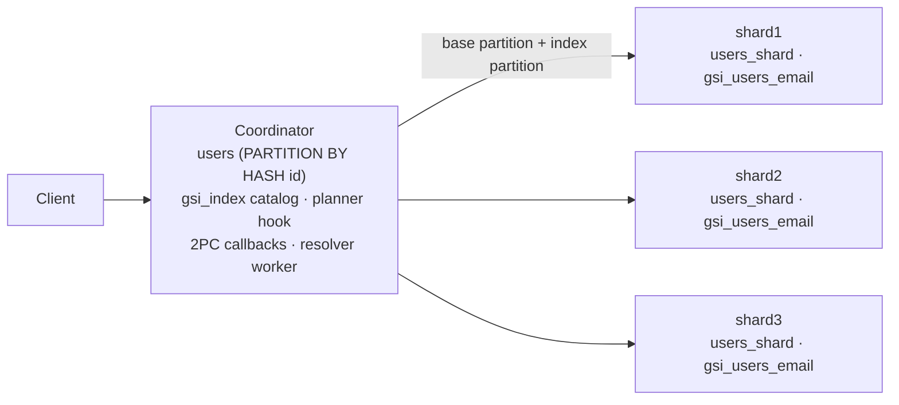
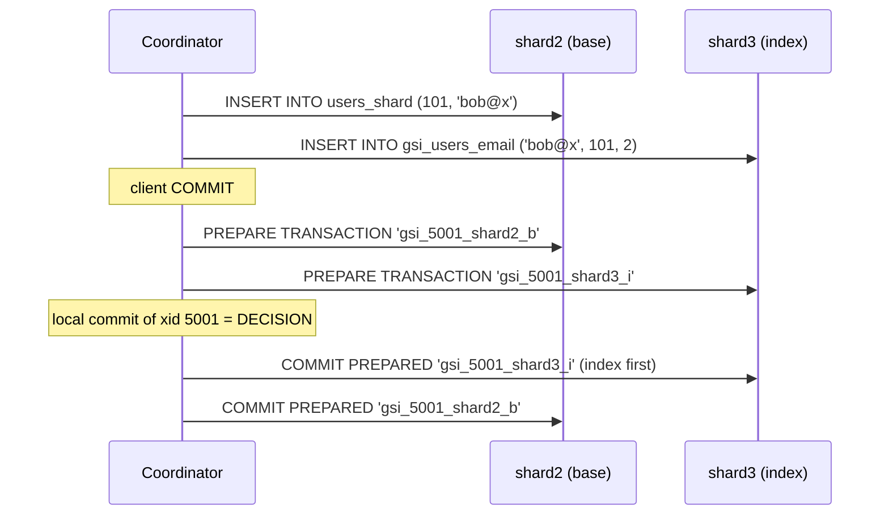

# Distributed GSI Maintenance for Sharded PostgreSQL: Architecture Plan

**Team:** Kunj Bhesaniya (23B0995), Dhruvraj Merchant (23B1041), Dipen Sojitra (23B0913), Harshil Solanki (23B1016)
**Course:** CS 631 · **Target:** PostgreSQL 16

---

## 1. Problem

`users` is hash-sharded by `id` across data nodes. Two things break:

1. **Lookups on other columns broadcast.** `WHERE email = ?` has no routing information, so the coordinator queries every shard. The cost grows with N.
2. **`UNIQUE(email)` can't be enforced.** Each shard sees only its own rows, so two shards can accept the same email at the same time.

Core PostgreSQL has no global indexes, and Citus has only shard-local ones.

## 2. Core idea

- One **global secondary index (GSI)** per indexed column. It's partitioned by the *indexed key*, independently of the base table: the entry for key `k` lives on index node `hash(k) mod N`.
- **One entry per row:** `(key, id, shard)`. Storing `id` gives exact primary-key fetches and exact deletes. `shard` is derivable from `hash(id) mod N` today; we keep it so the read path doesn't depend on the base placement function (cheap insurance for resharding).
- **Lookup = two hops:** ask one index node, then fetch `WHERE id = ANY(...)` from only the shards it named.
- **Uniqueness (optional, per index):** a GSI is non-unique by default; many rows may share a key. If created with `is_unique = true`, every entry for a key lands on the same node, so a local `UNIQUE` B-tree there enforces it globally. Nothing else in the design depends on uniqueness.
- **The hard part:** every write now touches two nodes (base shard and index node). They must commit atomically and survive crashes. That's the focus of this project.

## 3. Scope

| Core (must work) | Stretch (only after core) |
|---|---|
| Docker cluster: 1 coordinator + 3 data nodes | Async maintenance via logical decoding |
| Sync maintenance with 2PC + crash resolver + global uniqueness | Online index build (F1 states) |
| Read routing via planner hook + CustomScan | |
| Consistency checker, fault injection, benchmarks | |

---

## 4. Cluster and packaging

- Docker Compose with four `postgres:16` containers: `coordinator`, `shard1`, `shard2`, `shard3`. They reach each other through Docker DNS names.
- Every data node is **dual-role**: it holds one base partition *and* one index partition. A row's base data and its index entry usually sit on different nodes.
- Required settings:
  - All nodes: `max_prepared_transactions = 100` (2PC is disabled at 0).
  - Coordinator: `shared_preload_libraries = 'gsi_fdw'` (planner hook, transaction callbacks, resolver worker).
  - Async stretch only: `wal_level = logical` on data nodes.
- **Code:** one C extension, `gsi_fdw`, a modified copy of `contrib/postgres_fdw`. It reuses postgres_fdw's connection cache and per-server remote transactions, which both 2PC and index writes need. The data nodes run stock PostgreSQL (plus a small decoder plugin for async).



## 5. Schemas

**Coordinator:**

```sql
CREATE TABLE gsi.gsi_index (
    index_name  name PRIMARY KEY,          -- e.g. users_email; data-node table is gsi_<index_name>
    base_table  regclass NOT NULL,
    column_name name NOT NULL,
    is_unique   boolean NOT NULL DEFAULT false,
    mode        text NOT NULL DEFAULT 'sync',   -- sync | async
    status      text NOT NULL DEFAULT 'ready'   -- write-only | ready
);

CREATE TABLE users (id bigint PRIMARY KEY, email text NOT NULL, name text)
    PARTITION BY HASH (id);
CREATE FOREIGN TABLE users_p0 PARTITION OF users
    FOR VALUES WITH (MODULUS 3, REMAINDER 0) SERVER shard1 OPTIONS (table_name 'users_shard');
-- users_p1 -> shard2, users_p2 -> shard3
```

A two-column table `gsi.gsi_node(node_id, server_name)` maps index node numbers `0..N-1` to the existing foreign servers. Connection details stay in `pg_foreign_server`.

**Every data node** uses the same table names:

```sql
CREATE TABLE users_shard (id bigint PRIMARY KEY, email text NOT NULL, name text);

CREATE TABLE gsi_users_email (key text NOT NULL, id bigint NOT NULL, shard int NOT NULL,
                              PRIMARY KEY (key, id));     -- exact deletes, idempotent upserts
CREATE UNIQUE INDEX ON gsi_users_email (key);             -- only for a UNIQUE GSI
```

**Placement function:** `hash(key) mod N`, using the column type's extended hash function (the same one hash partitioning uses). The write path, read path, backfill and applier must all call the **same** C helper.

---

## 6. Read path

### 6.1 Planning
`set_rel_pathlist_hook` fires on the partitioned `users` rel. If `baserestrictinfo` contains `indexed_col = Const` (or a `Param`) and the GSI's status is `ready`, it adds a `GsiLookup` CustomPath. The path is costed at about 2 round trips plus a few rows, which is cheaper than the Append over N foreign scans. Otherwise it does nothing, and the normal broadcast plan runs.

### 6.2 Execution
1. `node = hash(const) mod N`
2. **Hop 1:** `SELECT id, shard FROM gsi_users_email WHERE key = $1` on that node.
3. Group the ids by shard.
4. **Hop 2:** for each shard that appears, `SELECT ... FROM users_shard WHERE id = ANY($1)`. Shards with no matches receive no query.
5. **Recheck** `email = const` on every returned row before emitting it.

### 6.3 Why recheck, and why no locks
- Each node is MVCC: reads take a local snapshot and take no locks. **There is no snapshot shared across nodes**: hop 1 and hop 2 see slightly different moments.
- So the index is treated as a *hint*. A stale entry (the row was updated or deleted in between) yields a base row that fails the recheck, or no row at all. **A wrong row is never returned.** PostgreSQL itself works this way: heap visibility checks and `Recheck Cond`.
- The recheck costs one comparison per row. Distributed read locks would make readers block writers and would need cross-node deadlock detection.
- **A row is never missed** once its base row is visible, because index nodes commit first (§7.4).
- Each single-row result corresponds to some real moment in time. If the caller needs the row to stay unchanged, `SELECT ... FOR UPDATE` locks it on the base shard in hop 2, and the recheck runs on the locked version.
- **Known limitation:** a multi-row result (a non-unique key spread over shards) can mix states from before and after a concurrent transaction. Fixing that needs global snapshots, which are out of scope.

### 6.4 Range predicates
Optional. Hashing destroys key order, so send the range to **all** index nodes in parallel, merge the `(id, shard)` results, and continue from step 3. This is still cheaper than scanning every base shard.

---

## 7. Synchronous write path and 2PC

### 7.1 Intercepting row changes
| Change in `gsi_fdw` | Why |
|---|---|
| `PlanDirectModify` returns false for GSI tables | Otherwise `UPDATE ... WHERE` is pushed down whole and the per-row callbacks never run. |
| `GetForeignModifyBatchSize` returns 1 | Same reason for batched `INSERT`. |
| `AddForeignUpdateTargets` adds the indexed column | `UPDATE`/`DELETE` need the **old key** to find the old entry. |

Per-row actions. Each index statement runs **immediately** on the index node's connection, inside that connection's remote transaction:

| Operation | Base shard | Index node(s) |
|---|---|---|
| INSERT | insert row | `INSERT (new_key, id, shard)` on `hash(new_key)` |
| DELETE | delete row | `DELETE WHERE key=old_key AND id=id` on `hash(old_key)` |
| UPDATE, key unchanged | update row | nothing |
| UPDATE, key changed | update row | delete old entry on `hash(old_key)`, insert new entry on `hash(new_key)` |

Running the index statement immediately (rather than at commit) makes a uniqueness conflict surface at the offending statement. The index-node row locks are also taken at the same time as the base-row locks.

postgres_fdw keeps **one remote transaction per server**. If the base shard and the index node are the same server, both changes are in the same remote transaction.

### 7.2 Commit protocol
postgres_fdw normally sends a plain `COMMIT` to each server in `XACT_EVENT_PRE_COMMIT`. If one server commits and another fails, the result is half-applied. `gsi_fdw` changes `pgfdw_xact_callback`:

**0. Force a coordinator xid.** At the first GSI write, call `GetTopTransactionId()`. Without this, a transaction that writes only to remote servers has no local xid and leaves no commit record. Then there's nothing to decide on, and nothing for the resolver to check.

**1. Prepare (`XACT_EVENT_PRE_COMMIT`).** Send `PREPARE TRANSACTION '<gid>'` to every participating server, where

```
gid = gsi_<coord_fxid>_<server>_<role>      role = i (holds any index change) | b (base only)
```

`coord_fxid` is the 64-bit full xid (`xid8`), so it never wraps around. If **any** PREPARE fails, `ereport(ERROR)` aborts the local transaction, and the abort path (step 3') rolls back the servers that did prepare.

**2. Decision (local commit).** PostgreSQL writes and flushes the coordinator's commit record. **This record is the single decision point.** If it's on disk, the distributed transaction is committed. If it isn't, the transaction is aborted.

**3. Finish (`XACT_EVENT_COMMIT`).** Send `COMMIT PREPARED` to every `_i` server first, then to every `_b` server. Errors here are only logged (the decision is already made), and the resolver finishes any server left behind.

**3'. Abort (`XACT_EVENT_ABORT`).** Send `ROLLBACK PREPARED` to servers that prepared, and plain `ROLLBACK` to the rest.



### 7.3 Global uniqueness
Example with a unique GSI on `email`:
- T1 inserts `(5, 'alice@x')`: the base row goes to shard2, the entry to `hash('alice@x') mod 3`, say shard3.
- T2 concurrently inserts `(9, 'alice@x')`: the base row goes to shard1, but the entry goes to **shard3 as well**.
- T2's index insert finds T1's uncommitted entry in the unique B-tree and **waits**. That includes waiting while T1 is in PREPARED state.
  - If T1 commits, T2 gets `unique_violation` (23505) during its INSERT statement, and its whole distributed transaction, including the shard1 base row, is rolled back.
  - If T1 aborts, T2 proceeds.

There are no cross-node locks; PostgreSQL's own unique-index locking does the work.

### 7.4 Why index nodes commit first
Between two `COMMIT PREPARED`s there is always a window where one node has committed and the other hasn't.

| Window state | A reader of `email = k` sees | Recoverable? |
|---|---|---|
| **Base committed, index not** | Hop 1 finds no entry → **row missed** | No. The read path can't know the row exists. |
| **Index committed, base not** | Entry found → base row not visible yet → recheck drops it → 0 rows (the write is still in flight) | Yes. Just a wasted fetch. |

The second state is harmless and the first is not, so **index servers (`_i`) always commit before base-only servers (`_b`)**. The resolver keeps the same order. For a DELETE, index-first means the entry disappears slightly before the base row does, which reads like the delete has already taken effect. That's acceptable.

---

## 8. Crash recovery: the resolver

### 8.1 What it solves
A prepared transaction on a data node **outlives crashes**. It keeps its locks and stays invisible until someone says `COMMIT PREPARED` or `ROLLBACK PREPARED`. If the coordinator dies after PREPARE, nobody will say it, rows stay locked forever, and the index and base can disagree. The resolver is the "someone".

### 8.2 Design
A background worker on the coordinator, registered in `_PG_init`. Every 5 s, and at startup, it does the following:

```
for each foreign server s:
    rows = SELECT gid FROM pg_prepared_xacts WHERE gid LIKE 'gsi_%'      -- on s
    for each gid older than a grace period (e.g. 10 s, from the 'prepared' column):
        fxid = parse(gid)
        st   = pg_xact_status(fxid)                                    -- on the coordinator
        committed   -> COMMIT PREPARED gid    (handle all _i gids before _b gids)
        aborted     -> ROLLBACK PREPARED gid
        in progress -> skip (the owning backend is still working)
```

Why this simple version is correct:
- **The decision is only ever read, never made.** The resolver just copies the coordinator's commit record. It can't disagree with the backend that ran the transaction.
- **"In progress" never gets stuck.** If a backend crashes, the postmaster restarts the whole instance, and crash recovery marks every unfinished xid as aborted. So "in progress" really means alive.
- **Racing a live backend is harmless.** Both would send the same `COMMIT PREPARED`. The loser gets "prepared transaction does not exist", which is ignored. The grace period keeps this rare.
- **Data-node crash:** prepared transactions survive the node's restart (they're in its WAL), so the next sweep finishes them.

| Crash point | Coordinator status | Resolver action |
|---|---|---|
| Before PREPARE | aborted | nothing; remote sessions roll back when the connection drops |
| After PREPARE, before local commit | aborted | `ROLLBACK PREPARED` everywhere |
| After local commit, before any COMMIT PREPARED | committed | `COMMIT PREPARED`, index first |
| After index COMMIT PREPARED, before base | committed | `COMMIT PREPARED` the remaining base servers |

---

## 9. Stretch: asynchronous maintenance

- Writes touch only the base shard: no index work, no 2PC.
- Base tables use `REPLICA IDENTITY FULL` so the old key is in WAL.
- `gsi_decoder` (a C logical-decoding output plugin on each data node) emits `(op, old_key, new_key, id)` for GSI tables, only for **committed** transactions.
- An applier background worker on the coordinator (one per data node) reads that node's slot and applies changes to the index nodes. Changes must be idempotent, because delivery is at-least-once:
  - insert: `INSERT ... ON CONFLICT (key, id) DO NOTHING`
  - delete: `DELETE WHERE key = old_key AND id = id`
  - update: delete old, insert new
- The slot position is confirmed **only after** the index write commits, so a crash replays changes and never loses one.
- **Lag:** current WAL LSN minus confirmed LSN.
- **Trade-off:** no global uniqueness, because conflicts are only discovered after both base writes have committed. The read-path recheck still prevents wrong rows, but rows can be **missed** until the applier catches up.

## 10. Stretch: online index build (F1)

**Goal:** create a GSI on a table that already has rows, without blocking reads or writes. The approach follows F1's schema-change states (Rae et al., VLDB 2013): at every moment the index is either complete or not used for reads.

```
(absent) → write-only → [backfill → validate] → ready
```

The catalog only stores `write-only` and `ready`; backfill and validate are steps that run while the status is `write-only`.

**Step 1: `write-only`.** `gsi_create(table, column, is_unique, mode)`:
1. Creates `gsi_<name>` on every data node.
2. Inserts the catalog row with status `write-only` and commits.
3. **Waits until every transaction that was already running at that moment has finished.** Those transactions may have looked up the catalog before the index existed, so their writes skip the index. Once they're gone, every write maintains the index. This is the same wait `CREATE INDEX CONCURRENTLY` does.
- The write path (§7) maintains the index for `write-only` and `ready`; the planner hook (§6.1) uses it only for `ready`.
- The GSI catalog is read per statement (or cached with relcache invalidation on the base table), so a status change is seen by the next statement.

**Step 2: backfill.** A background worker walks each shard in id chunks. Each chunk is **one ordinary distributed transaction through `gsi_fdw`**:

```sql
BEGIN;
SELECT id, email FROM users WHERE id BETWEEN $lo AND $hi FOR SHARE;   -- locks the base rows
-- for each row: INSERT INTO gsi_users_email VALUES (email, id, shard)
--               ON CONFLICT (key, id) DO NOTHING                      -- on hash(email) node
COMMIT;                                                                 -- normal 2PC (§7.2)
```

Holding `FOR SHARE` locks until the 2PC commit is what makes the races safe:

| Concurrent client write | What happens |
|---|---|
| INSERT of a new row | Its sync path already wrote the entry; the backfill's `DO NOTHING` skips it |
| DELETE / UPDATE commits **before** the chunk locks the row | The chunk doesn't see the old version (on a serialization error the chunk is retried), so it creates no stale entry |
| DELETE / UPDATE comes **after** the chunk locked the row | It waits for the chunk to commit, then its sync path removes or replaces the entry the chunk just wrote |

So the backfill never leaves a stale entry, and a unique GSI never gets a false conflict from a deleted row. Chunks are small (e.g. 1,000 ids), so locks are short. If a chunk fails, it's retried. The worker records the last finished chunk, so it can resume after a crash.

**Uniqueness during backfill:** for a unique GSI, two existing rows with the same key make a backfill insert fail with `unique_violation`. The build then stops, reports the conflicting key, and drops the index (status never reaches `ready`).

**Step 3: validate.** Run the consistency checker (§12) for this one index: the index entries must equal `{(key, id, shard)}` from the base shards. With the locking above this is a safety check, not a repair step. Any mismatch fails the build.

**Step 4: `ready`.** Set status to `ready`. New plans start using `GsiLookup`; cached plans are invalidated through the same relcache invalidation.

**What it reuses:** the sync write path, 2PC and the resolver. A coordinator crash mid-chunk is just an in-doubt transaction. New code: `gsi_create()`, the wait for running transactions, the backfill worker loop, and the status check in the planner.

---

## 11. Sync vs async

| | Sync (core) | Async (stretch) |
|---|---|---|
| When the index is updated | In the same transaction, via 2PC | After commit, from the WAL stream |
| Write latency | Higher: extra index write + PREPARE + COMMIT PREPARED round trips | Same as no index |
| Index freshness | Consistent at commit | Lags by the replication delay |
| Reads | Never wrong, never miss committed rows | Never wrong (recheck), may miss recent rows |
| Global uniqueness | Yes | No |
| Failure handling | Resolver for in-doubt prepared transactions | Slot replay from the last confirmed position |
| Main code | FDW callbacks, xact callback, resolver | Decoder plugin, applier worker |

---

## 12. Evaluation

- **Consistency checker:** after a randomized concurrent workload, quiesce, read all base rows `{(id, key, shard)}` and all index entries, and assert both sets are equal. Also assert there are no leftover `gsi_%` prepared transactions.
- **Fault injection:** a GUC `gsi.fail_point = after_prepare | after_local_commit | mid_commit_prepared` that does `abort()` at that step. Restart, wait for the resolver, then run the checker. Separately, `docker pause` a shard during PREPARE to test the abort path.
- **Benchmarks (pgbench):**
  - Write TPS and latency: no index vs sync (vs async).
  - Point lookup latency: GSI vs broadcast with 2, 3 and 4 shards.
  - Async lag under load.

## 13. Known limitations
- No cross-node snapshot: multi-row reads can be fractured during the commit window.
- No global uniqueness in async mode.
- The node count is fixed; resharding isn't supported.

## 14. Repository layout (planned)

```
docker/          docker-compose.yml, configs, init SQL
src/gsi_fdw/     modified postgres_fdw: planner hook, CustomScan, modify callbacks, 2PC, resolver
src/gsi_decoder/ logical decoding plugin (stretch)
tests/           integration, fault injection, consistency checker
benchmarks/      pgbench scripts and runner
docs/            this plan, diagrams
```

## References
Diff-Index (EDBT 2014) · F1 online schema change (VLDB 2013) · Spanner (OSDI 2012) · *Database System Concepts*, Ch. 21–23.
