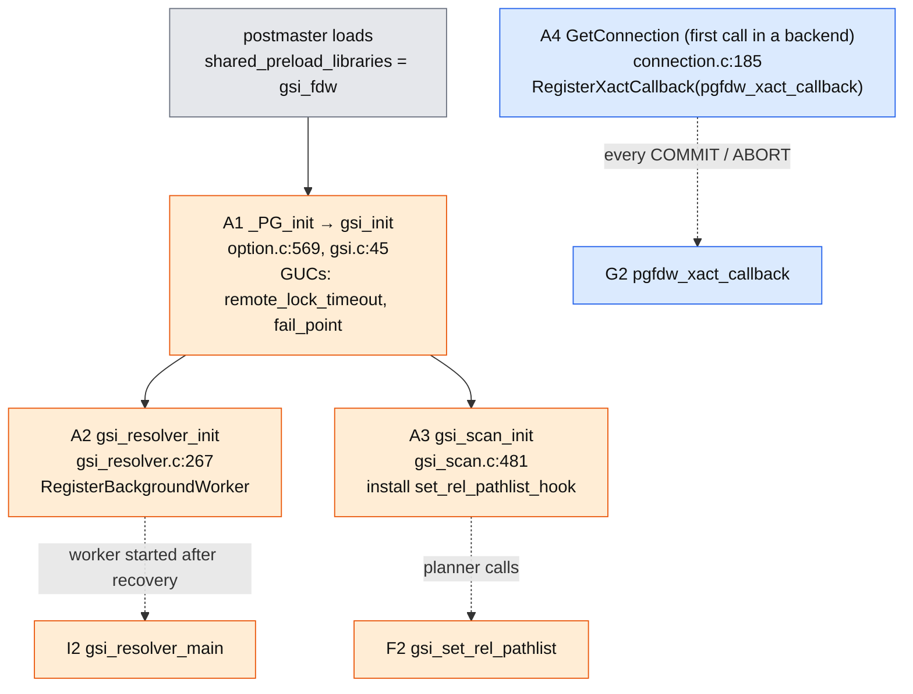
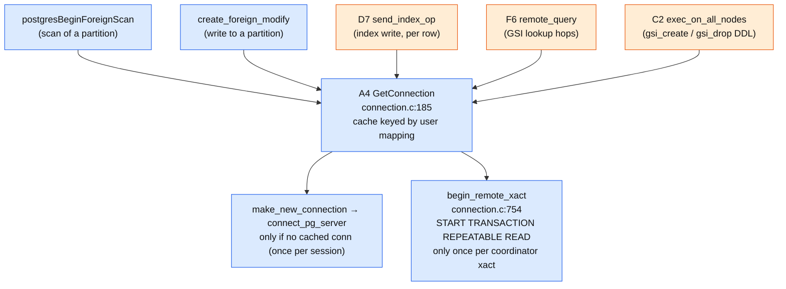
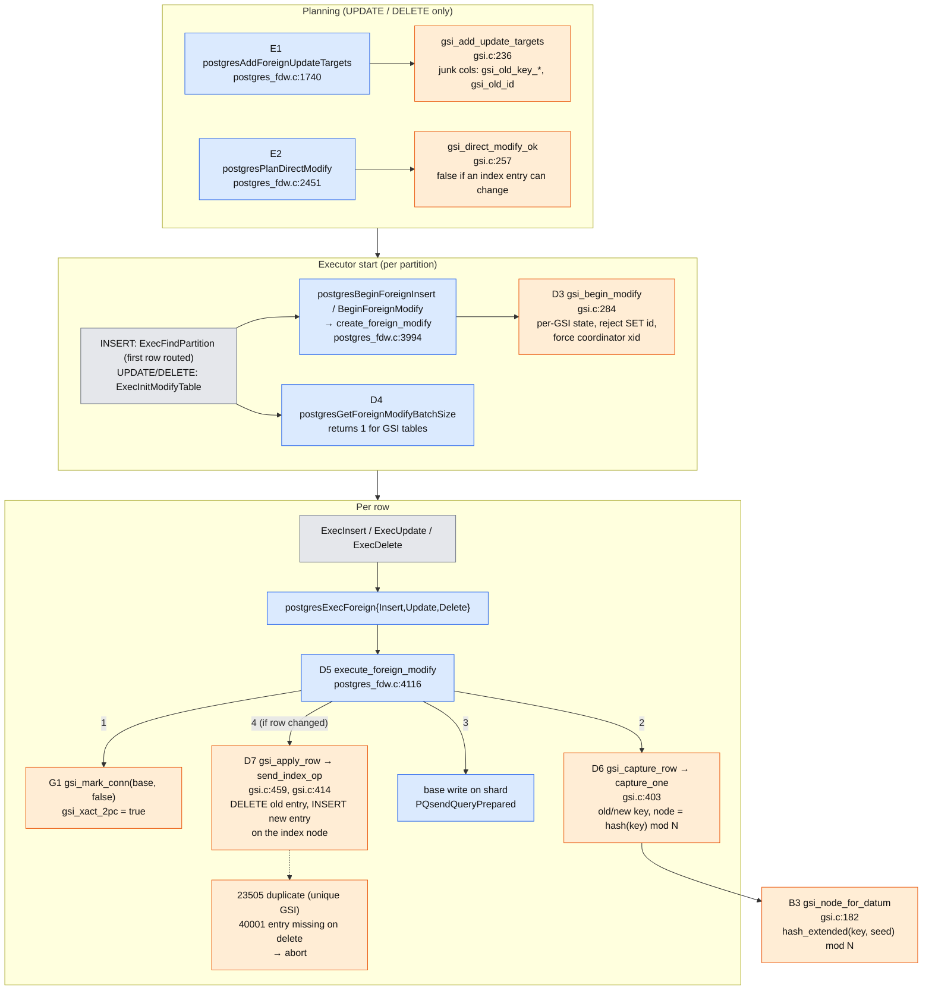
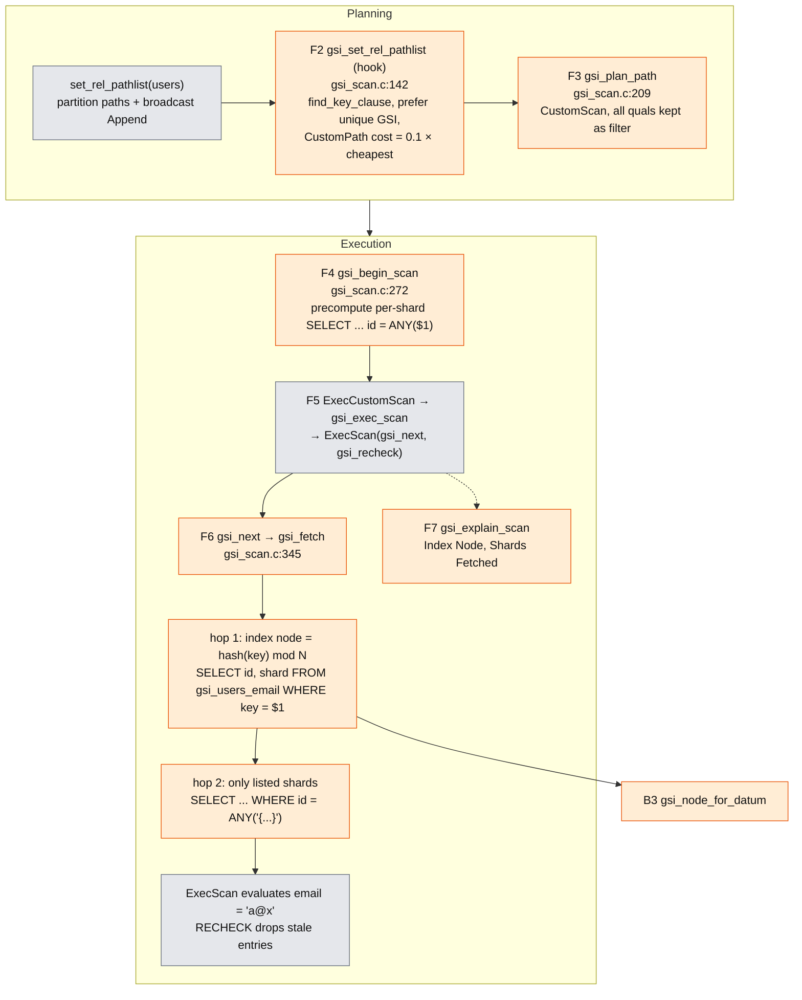
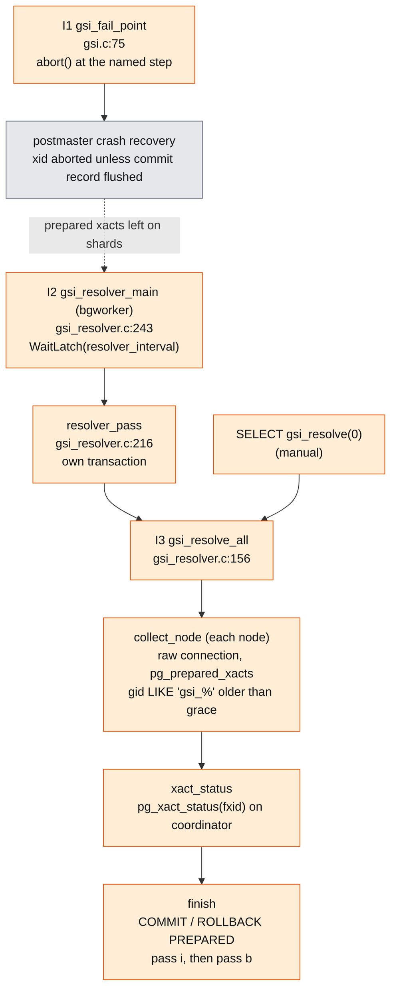

# Call Graph: gsi_fdw

How PostgreSQL core, postgres_fdw and our GSI code call each other for the main statements. Detailed per-statement stacks with line links: [call_stacks.md](call_stacks.md).

**Colors:** grey = PostgreSQL core, blue = unchanged postgres_fdw, orange = our GSI code (new, or a GSI change inside postgres_fdw). IDs (A1, D5, ...) match the walkthrough. Delete any node you don't want, along with its arrows.

Diagrams are [Mermaid](https://mermaid.js.org/). They render on GitHub; in VS Code install "Markdown Preview Mermaid Support" and open the preview (Ctrl+Shift+V).

---

## 1. Startup and hooks

---

## 2. Connections and remote transactions

---

## 3. Write path: INSERT / UPDATE / DELETE

---

## 4. Commit and abort (2PC)

```mermaid
flowchart TD
    classDef pg fill:#e5e7eb,stroke:#6b7280,color:#111
    classDef fdw fill:#dbeafe,stroke:#2563eb,color:#111
    classDef gsi fill:#ffedd5,stroke:#ea580c,color:#111
    classDef decision fill:#fee2e2,stroke:#dc2626,color:#111

    CT["CommitTransaction"]:::pg
    PRE["XACT_EVENT_PRE_COMMIT<br/>→ pgfdw_xact_callback<br/>connection.c:994"]:::fdw
    LX["gsi_log_xid<br/>connection.c:2320<br/>flush WAL record with the xid"]:::gsi
    PR["G2 gsi_prepare_remote_xact (each participant)<br/>connection.c:2327<br/>PREPARE TRANSACTION 'gsi_#lt;fxid#gt;_#lt;server#gt;_#lt;i|b#gt;'"]:::gsi
    FP1["fail point: after_prepare"]:::gsi
    RC["G3 RecordTransactionCommit<br/>DECISION POINT"]:::decision
    POST["XACT_EVENT_COMMIT<br/>→ pgfdw_xact_callback"]:::fdw
    FIN["G4 gsi_finish_prepared(true)<br/>connection.c:2355"]:::gsi
    P0["pass 0: COMMIT PREPARED on index nodes (i)"]:::gsi
    P1["pass 1: COMMIT PREPARED on base shards (b)"]:::gsi
    W["failure → WARNING + disconnect<br/>left for the resolver"]:::gsi

    CT --> PRE --> LX --> PR --> FP1 --> RC --> POST --> FIN
    FIN -->|"fail point: after_local_commit"| P0
    P0 -->|"fail point: mid_commit_prepared"| P1
    FIN -.-> W

    AB["AbortTransaction (ERROR or ROLLBACK)"]:::pg
    ABE["XACT_EVENT_ABORT → pgfdw_xact_callback"]:::fdw
    H1a["H1 gsi_finish_prepared(false)<br/>ROLLBACK PREPARED (already prepared ones)"]:::gsi
    H1b["pgfdw_abort_cleanup<br/>ABORT TRANSACTION (still open ones)"]:::fdw
    PR -. "PREPARE fails" .-> AB
    AB --> ABE --> H1a
    ABE --> H1b
```

---

## 5. Read path: `SELECT ... WHERE email = 'a@x'`

---

## 6. Crash recovery

